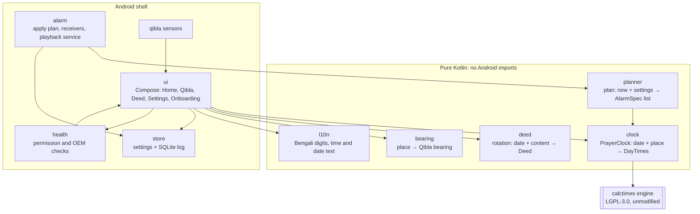
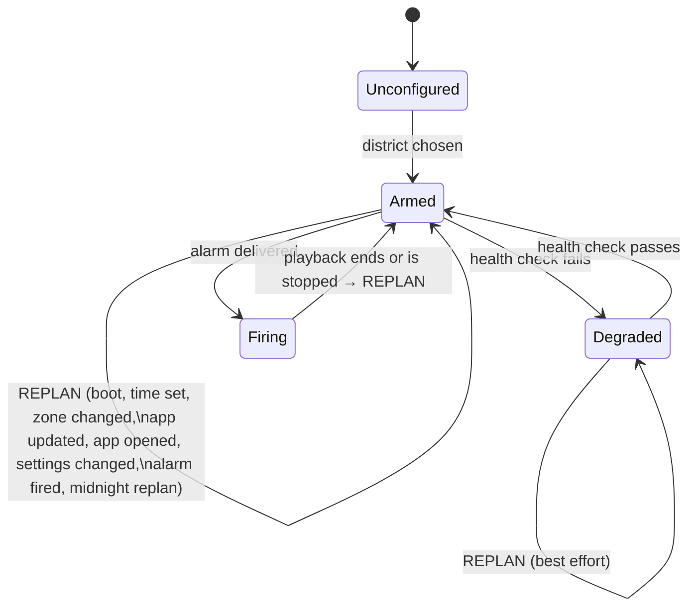

# 03 · Architecture

Labels and shorthand are as in `00-base-audit.md`. This file describes the design; it contains no application code.

**One sentence.** One Android app, one app module plus a plain Kotlin core (ADR-9), no backend, no network, with a pure core (time engine wrapper, alarm planner, deed rotation) and a thin Android shell around it.

## Context

There is no server box in this diagram, on purpose.

## Components

Rule: nothing in `pure` may import `android.*`. CI enforces it with a text check (no extra dependency).

## The time engine as a pure library

**Interface (described, not coded).**

- Input: `date`, `place` (latitude, longitude, fixed elevation, zone id), `settings` (Asr convention, per-prayer offsets in minutes, Sehri margin).
- Output: either `DayTimes` (sehriEnd, fajr, sunrise, dhuhr, asr, maghrib, isha, each an instant in the place's zone) or `NotComputable(prayer, reason)`.
- Errors are values. The wrapper never returns 00:00 for a failure (INV-T7; the engine does: KNOWN, `E/DoubleTimes.kt`).
- Method is fixed to Karachi (KNOWN present: `E/Method.kt`). Elevation comes from the district table, not GPS.
- The wrapper passes user offsets through the engine's own per-prayer minute fields (KNOWN to exist: `E/Method.kt`), so there is one offset mechanism, not two as in the base (audit §2).

**Property tests.** Random dates across 2020-2040 and random points in Bangladesh's bounding box:

1. Order: `sehriEnd ≤ fajr < sunrise < dhuhr < asrShafi < asrHanafi < maghrib < isha` (INV-T1).
2. `iftar == maghrib`; `sehriEnd == fajr − margin` under the agreed rounding (INV-T2, INV-T5).
3. Determinism: result is identical whatever the JVM default zone and locale (INV-T3).
4. Offset linearity: offset N on one prayer shifts only that prayer by N (INV-T6).
5. Continuity: from one day to the next, no time moves by more than 3 minutes **(target)**; catches date and zone slips.
6. Zone stability: converting results to UTC gives the same instants whether the device zone is Asia/Dhaka, UTC or America/New_York.

**Fixture tests.** A committed table of the reference timetable for eight cities × 365 days (INV-T4). Source is Q2.

## The scheduler as a state machine

**The base's model** is "one alarm, each fires and sets the next" (KNOWN, audit H4). **The new model** is "always hold the next 24 hours; replan on every trigger".

**Pure part: `plan(now, settings) → AlarmSpec[]`.** Each spec has a stable id, an instant, a kind (adhan · tone · silent · pre-reminder · replan) and a prayer. The plan always includes every enabled prayer in `[now, now + 24 h]` plus one `replan` spec shortly after local midnight. Being pure, it is tested without a device (INV-S2).

**Android part: `apply(plan)`.** Cancel every id in the fixed id space, then register the plan. The id space is small and closed (4 day-slots × 16 kinds = 64 ids; id = `epochDay mod 4` × 16 + kind slot, so the same alarm keeps its id across replans), so "cancel all, set all" is cheap and makes scheduling idempotent (INV-S4).

**Events that trigger REPLAN.** Boot completed; time set; time-zone changed; my-package-replaced; exact-alarm permission state changed; app brought to foreground; any settings change; any alarm delivered; the midnight replan alarm. The base handles the first three and app start only (KNOWN, audit §3).

**Persisted.** Settings (district, offsets, per-prayer mode, silent-mode choice). The alarm log (planned instant, delivered instant, outcome), trimmed to 30 days. **Not persisted:** the plan itself. It is always recomputed, so it cannot go stale.

**Health check → Degraded reasons, each with its own message and one-tap fix.**

| Reason | Detected by | Label |
|---|---|---|
| Exact alarms not allowed | `canScheduleExactAlarms()` | KNOWN API (alarms doc) |
| Notifications blocked | Notification manager state | ASSUMED API |
| Battery optimisation applies to the app | `isIgnoringBatteryOptimizations` | KNOWN, used in `A/times/utils/BatteryOptimizations.kt` |
| An alarm in the last 7 days was delivered more than 2 min late, or never | The alarm log | Own design |
| Manufacturer known for killing apps, and the user has not confirmed the per-brand steps | `Build.MANUFACTURER` | ASSUMED |

**Delivery.** Adhan alarms use `setAlarmClock`, as the base does by default (KNOWN, `A/MyAlarmManager.kt`); the platform documents it as leaving low-power modes to deliver (KNOWN, alarms doc). Silent and pre-reminder alarms use `setExactAndAllowWhileIdle`. On delivery the app starts a `mediaPlayback` foreground service, as the base does (KNOWN, `AlarmService.kt`), holds a wake lock for the length of the recording plus a margin, plays, logs, replans.

**How each Phase 2 failure mode is handled.**

| F1 # | Handling |
|---|---|
| 1 Doze | `setAlarmClock` |
| 2 OEM killer | 24-hour window means one lost process does not break the chain; log exposes misses; per-brand onboarding |
| 3, 12 Exact permission | Degraded state with visible warning; replan on permission-state broadcast |
| 4 Notifications blocked | Degraded state; playback does not depend on the notification (ASSUMED; verify) |
| 5 No location | Stored district only |
| 6, 7 Spoof / travel | Ask before changing district |
| 8 Zone mismatch | Planner works in the place's zone (INV-S2) |
| 9, 10, 11 Clock, boot, update | REPLAN events |
| 13 Midnight | Planner works on instants, not on "today's list"; no hour heuristic |
| 15, 16 Silent, call | Decided at delivery from the user's one setting and audio-focus state |
| 17 Late | INV-S7 rule at delivery |

**What cannot be guaranteed, and how the user is told.**

- **Force stop.** Nothing runs until the app is opened (ASSUMED platform behaviour). Onboarding states it once.
- **OEM "autostart" disabled.** After a reboot the app may not be allowed to start (KNOWN for Xiaomi, dontkillmyapp.com; other brands UNKNOWN). The Reminder-health screen shows the miss the next time the app is opened and repeats the brand steps.
- **Before first unlock after reboot.** UNKNOWN whether alarms set from a direct-boot receiver are worth the complexity. Measure on the matrix first; default is not to support it.
- **`setAlarmClock` side effect.** The system may show an alarm icon and treat the next Adhan as the phone's "next alarm" (ASSUMED). If users object, the fallback is `setExactAndAllowWhileIdle` for all kinds, with weaker Doze guarantees. Decide on device evidence.

## Data layer

| Data | Where | Why |
|---|---|---|
| Settings | Platform SharedPreferences, one file, versioned keys | Small, no dependency |
| Alarm log, deed completions | One SQLite database through the platform's own helper, two tables | No dependency; SQLite is what Quran search will need later |
| Deeds | `content/deeds.json`, packaged as an asset, parsed with the platform JSON parser | Reviewer-editable, diffable |
| Districts | `content/districts.json` asset: id, names (bn, en), latitude, longitude, elevation | 64 rows |
| Adhan audio | One file in `res/raw` | License: Q5 |

**Schema.** `alarm_log(id, prayer, kind, planned_utc, delivered_utc NULL, outcome)`; `deed_day(local_date PRIMARY KEY, deed_id, content_version, swapped, done_at NULL)` (was `deed_done`; one row per day the card was shown, amended 2026-11-26, G5). **Migrations.** Numbered SQL files applied in order; a test opens each historical schema and migrates to current.

**Backup.** Settings and deed completions may be included in Android's backup; the alarm log is excluded. After a restore the health check runs (failure mode 12). Exact backup-rule syntax: UNKNOWN here, take from Android docs.

**Size budget (targets).** Code and resources ≤ 6 MB, audio ≤ 2 MB, content ≤ 0.1 MB, total download ≤ 15 MB. Actuals: UNKNOWN until the first build.

**Bundled vs downloaded.** v1: everything bundled, nothing downloaded.

## Localization architecture

| Topic | Decision | Label |
|---|---|---|
| Default locale | Bengali strings live in the default `values/` folder; English in `values-en/`. A phone in any other language sees Bengali. A per-app language setting offers বাংলা / English | Design choice; per-app locales are KNOWN supported by the base (`locales_config.xml`) |
| Completeness | Build fails on any key missing in either language (INV-L1) | The base's 37 % Bengali coverage is the cautionary case (audit H2) |
| Digits | One pure function maps 0-9 to ০-৯ for all numbers shown in Bengali; property-tested over all ten digits. The base's version skips 9 and has no Bengali (KNOWN, `LocaleUtils.kt:225`) | Design choice |
| Time format | 12-hour with Bengali day-part words (ভোর, দুপুর, বিকাল, সন্ধ্যা, রাত) as the default; 24-hour as an option. Wording to be confirmed with native speakers | ASSUMED preference; test with users |
| Dates | Gregorian date in Bengali. Bengali-calendar and Hijri dates are **not** in v1 | Cut; Hijri needs the ±1 decision |
| Plurals | Android plural resources for every counted phrase, even where Bengali uses one form | ASSUMED Bengali has one/other forms only; verify in CLDR |
| Arabic inside Bengali/English | Wrap every Arabic run in Unicode directional isolates through the platform's bidi helper | ASSUMED API |
| Fonts | Start with system fonts. Check Bengali conjuncts and Arabic diacritics on every phone in the matrix. Bundle a font only if a phone fails | UNKNOWN until tested; a bundled Bengali font costs install size (amount UNKNOWN) |
| Text expansion | Layouts sized for the longer of the two languages at 200 % font scale (INV-L4) | |
| Translation process | Bengali is written first by a native speaker, not machine-translated from English. No Crowdin in v1: two languages do not need it | Cut |

## Privacy architecture

**Permission allowlist. The build fails if the merged manifest differs (INV-P3).**

| Permission | Reason shown to the user |
|---|---|
| `USE_EXACT_ALARM` (Android 13+) and `SCHEDULE_EXACT_ALARM` (Android 12) | Ring the Adhan at the exact time. See ADR-4 |
| `RECEIVE_BOOT_COMPLETED` | Set the alarms again after a restart |
| `POST_NOTIFICATIONS` | Show the prayer notification |
| `FOREGROUND_SERVICE`, `FOREGROUND_SERVICE_MEDIA_PLAYBACK` | Play the Adhan |
| `WAKE_LOCK` | Keep the phone awake while the Adhan plays |

Removed relative to the base (KNOWN list, audit §3): `INTERNET`, `ACCESS_NETWORK_STATE`, `ACCESS_FINE_LOCATION`, `DISABLE_KEYGUARD`, `ACCESS_NOTIFICATION_POLICY`, `FOREGROUND_SERVICE_SPECIAL_USE`, `SET_ALARM`, `INSTALL_SHORTCUT`.

**Network allowlist.** Empty. `INTERNET` is not declared (INV-P1). A CI check greps the merged manifest.

**Crash reporting.** None automatic. A "Send a report" button in Settings opens the user's email app with a plain-text draft they can read: app version, Android version, manufacturer and model, health-check results, the 7-day alarm log. No identifiers. The user chooses whether to send. This is the only way information leaves the phone, and it does not need the `INTERNET` permission.

**Location.** The app does not read the phone's location and declares no location permission (ADR-12). The user picks a district by hand; what is stored is the district id and its centre's coordinates. Adding location back needs an ADR and the founder's yes (INV-P3).

**Vibration.** Not used and not declared (ADR-12). Adding `VIBRATE` back needs an ADR.

## Dependency policy

Default answer is no. Allowlist (INV-P4):

| Dependency | License | Why it exists | Cost of removing |
|---|---|---|---|
| Kotlin stdlib | Apache-2.0 (ASSUMED) | Language | Not removable |
| `calctimes` engine | LGPL-3.0 (KNOWN) | Prayer time calculation | ADR-2 |
| `kotlinx-datetime` | Apache-2.0 (ASSUMED) | Required by the engine's API (KNOWN, `calctimes/build.gradle.kts`) | Goes if the engine is replaced |
| Jetpack Compose + Material 3 + Activity | Apache-2.0 (ASSUMED) | UI | A rewrite in Views; more code, not less |
| Test only: JUnit, a property-testing library (the base already uses Kotest: KNOWN) | (ASSUMED permissive) | Tests | None shipped |

Sizes: UNKNOWN until built. Verify every license from the generated dependency report before release.

**Explicitly refused:** Ktor, Ion, Room, WorkManager, DataStore, a DI framework, a navigation library, an image loader, Sentry or any crash SDK, Firebase, Google Play services, kotlinx-serialization, AboutLibraries, Flexmark. Each solved a problem v1 does not have.

## Build, release, update

- **Signing.** Play App Signing with an upload key kept offline and backed up. (Process details: take from Play Console at setup.)
- **Flavours.** None. One build.
- **Application id.** New and unrelated to `com.metinkale.prayer`.
- **Versioning.** `versionName` = `major.minor.patch`; a separate integer `contentVersion` for deeds.
- **Rollout.** Closed test with ≥ 12 testers for 14 days (KNOWN requirement), then staged production rollout at increasing percentages **(targets: 10 → 50 → 100 %, holding 48 h each)**, watching the "Send a report" inbox and Play's own vitals.
- **Content updates without code.** A content change touches only `content/*.json` and the reviewer's note, and ships as an ordinary app update. No Kotlin changes, no feature flags. Over-the-air content waits for the Quran work.
- **Store listing.** Bengali first, English second; screenshots from the redesigned UI only; no upstream assets.
- **Attribution.** A `NOTICE` file and an in-app "Open-source licences" screen credit prayer-times-android (Apache-2.0) for any ported code, and reproduce the engine's LGPL notices (KNOWN required by `calctimes/NOTICE.txt` and `open-prayer-times/README.md:65-72`).

## Forward path

| Later feature | Where it attaches | What v1 must not do |
|---|---|---|
| Quran, tafsir, audio | A new `packs` component: download, verify hash, store, index in the existing SQLite database. Adds `INTERNET`, allowlisted to one host | Must not scatter storage across files and preferences |
| Duas, daily hadith | Same content record shape and review gate as deeds | Must not hard-code "deed" into the gate |
| Salah tracker | A third table; a "Prayed" action on the notification the alarm component already posts | Must not let notifications be built in more than one place |
| Hijri, ±1 day | The engine repo's `hijri` module (Apache-2.0, KNOWN) behind the `clock` interface | Must not format dates outside `l10n` |
| Widgets | Read the planner's output | Must not let UI compute times itself |
| Paid tier | A single `entitlements` interface that returns "everything" in v1 | No billing code, no stubs beyond the one interface |
| Sync / accounts | Not planned. If ever: export/import of one file first | No account concepts in v1 |

---

## Decision records

### ADR-1 · New app that ports parts, not a pruned fork

- **Context.** The audit's deletion list removes most modules, both flavours' extras, all networking and 49 languages (audit §10). State is spread over SharedPreferences and static singletons (`A/times/times/TimesCompanion.kt`, `A/App.kt`), the scheduler has no tests, and upstream asks for a real redesign (`README.md:159-161`). Play disallows apps that merely replicate existing ones (KNOWN).
- **Options.** (a) Fork and delete down. (b) Start an empty project; port the engine call, the Qibla bearing maths and sensor filter, and the proven alarm delivery pattern, with attribution.
- **Decision.** (b).
- **Consequences.** More typing in week one. Far less inherited behaviour to understand. Upstream fixes no longer merge; they are read and ported by hand. Clear answer to both the author's request and the Play policy.
- **Reverse.** If slice 1 takes more than two weeks **(target)**, fall back to (a) using `00-base-audit.md` §10 as the deletion script.

### ADR-2 · Keep the LGPL engine, unmodified, behind an interface

- **Context.** `calctimes` is LGPL-3.0 (KNOWN). It is pure, already has Karachi and Hanafi, and is what the reference app ships.
- **Options.** (a) Use it unmodified as a separate library and comply with LGPL. (b) Replace it with a permissively licensed engine (candidates and their licenses: UNKNOWN, not researched in this run). (c) Write a new implementation from published astronomical formulas.
- **Decision.** (a) now. Do not modify the engine; if a change is ever needed, publish it. Get a written legal opinion on LGPL compliance in a Play-distributed app before any paid tier (Q6).
- **Consequences.** Licence notices in the app. A legal question stays open. No engine work in v1.
- **Reverse.** The `clock` interface plus the fixture table make a swap mechanical: any engine that passes T-FIX-4 and the property tests is acceptable.
- **Amended 2026-11-26 (founder decision, gap G1).** "Unmodified" could not stand. The engine's public output is already rounded, with Fajr rounded down, and it turns a failed calculation into 00:00 (KNOWN, `DoubleTimes.kt` at `a136f9b`), so INV-T5 and INV-T7 cannot be met from outside it. The engine is now **vendored at `engine/calctimes/` with one change**: `DoubleTimes` and `CalcTimes.getDoubleTimes` are public. The change is recorded in `engine/calctimes/MODIFICATIONS.md`. LGPL duty that follows: the modified engine source must be offered to anyone who gets the app; a public repository containing `engine/calctimes/` satisfies that (ASSUMED; part of Q6). Vendoring also closes G3: upstream publishes no artifact to depend on.

### ADR-3 · Hold a 24-hour window of alarms; recompute, never persist

- **Context.** The base holds one alarm and chains (KNOWN). One lost link silences the app until the next boot or app open, and its daily repair job needs internet (S1, S2).
- **Options.** (a) Keep the chain. (b) 24-hour window, replan on every event, cancel-all-then-set. (c) Schedule a week ahead.
- **Decision.** (b).
- **Consequences.** Up to about a dozen pending alarms instead of one. Losing any one costs one prayer, not all. (c) adds nothing: times drift daily and a replan happens daily anyway.
- **Reverse.** The planner's window length is one constant.
- **Amended 2026-11-26 (founder decision, gap G8).** The window is **48 hours**, not 24. With 24, a phone that freezes the app after the last alarm loses every reminder the same day, which is the base's failure delayed by a few hours. With 48 the user gets a further day of reminders, and a day in which opening the app once repairs everything. About twenty pending alarms instead of ten. "24 hours" elsewhere in this file and in `02` now reads 48.
- **Also decided 2026-11-26 (gap G16).** A prayer whose time has passed when the plan is made is skipped silently. An alarm is planned only if its instant is strictly after "now", so replanning while an alarm fires cannot ring it twice (INV-S5). A pre-reminder is 1 to 120 minutes, so it can never share an instant with its own prayer. Two different prayers' alarms may share an instant (a long pre-reminder landing on the previous prayer); both are planned and the shell plays them in order.

### ADR-4 · Exact-alarm permission

- **Context.** `USE_EXACT_ALARM` is granted at install and cannot be revoked, and is described for calendar and alarm-clock apps; `SCHEDULE_EXACT_ALARM` is user-granted, off by default on fresh installs targeting Android 13+, and revocable (all KNOWN, Android docs). Play requires that exact alarms be core functionality (KNOWN). Whether Play accepts an Adhan app under `USE_EXACT_ALARM`: UNKNOWN. The base declares both and is on Play (KNOWN it declares both; its Play review history is UNKNOWN).
- **Options.** (a) Declare both, as the base does. (b) `SCHEDULE_EXACT_ALARM` only, with a grant step in onboarding.
- **Decision.** (a), with the Degraded state and grant flow built regardless, so (b) is a manifest edit away.
- **Consequences.** Best reliability if accepted. A rejection costs one review cycle.
- **Reverse.** Remove one manifest line; the grant flow already exists.
- **Re-read 2026-11-27 (KNOWN, developer.android.com/about/versions/14/changes/schedule-exact-alarms and /develop/background-work/services/alarms).** The pages say an app targeting Android 13+ may declare "either" `SCHEDULE_EXACT_ALARM` or `USE_EXACT_ALARM`. They do not mention `maxSdkVersion` or declaring both, so the pairing stays ASSUMED. `USE_EXACT_ALARM` is "Granted automatically", cannot be revoked, and is "subject to an upcoming Google Play policy". On Android 12 and 12L the flow is: `canScheduleExactAlarms()`, then `ACTION_REQUEST_SCHEDULE_EXACT_ALARM`, then re-check in `onResume`; on `ACTION_SCHEDULE_EXACT_ALARM_PERMISSION_STATE_CHANGED` re-check and replan. Revocation stops the app and cancels its exact alarms. Built in `alarm/AlarmScheduler.kt`; the grant flow itself has not run (no API 31/32 device, T-INST-6).
- **Built 2026-11-26.** Both are declared; `SCHEDULE_EXACT_ALARM` carries `maxSdkVersion=32`, so Android 13 and later rely on `USE_EXACT_ALARM` alone (ASSUMED to be the recommended pairing; the alarms page read on 2026-11-26 does not state it). The machine-readable allowlists are `app/allowlist/permissions.txt` and `app/allowlist/dependencies.txt`; the tables in this file explain them, the files are what the build checks.

### ADR-5 · Platform storage only

- **Context.** v1 stores a handful of settings and two small tables.
- **Options.** (a) Room + DataStore. (b) SharedPreferences + platform SQLite helper.
- **Decision.** (b).
- **Consequences.** Hand-written SQL for two tables; no annotation processor, faster builds, two fewer dependencies.
- **Reverse.** Adopt Room when the Quran schema arrives, if hand-written SQL becomes the bottleneck.

### ADR-6 · No network in v1

- **Context.** The base sends coordinates to a server for city lookup (KNOWN, H5) and downloads sounds and data. The product promise is offline and private.
- **Options.** (a) Keep city search online. (b) Bundle 64 districts and one Adhan; declare no `INTERNET`.
- **Decision.** (b).
- **Consequences.** The privacy claim becomes checkable by anyone reading the permission list. Bangladesh only. No remote content fixes; a wrong deed needs an app update.
- **Reverse.** Add `INTERNET` with a one-host allowlist when content packs arrive.

### ADR-7 · No automatic crash reporting

- **Context.** The base's Play flavour sends crashes with a per-install id (KNOWN, H7). Mu'mins DAY's positioning forbids trackers, yet F1 cannot be perfected blind.
- **Options.** (a) Self-hosted crash collector, opt-in. (b) On-device log plus user-initiated email. (c) Nothing.
- **Decision.** (b), plus Play's built-in vitals, which need no SDK (ASSUMED).
- **Consequences.** Fewer reports, each with full consent and context. No server to run.
- **Reverse.** Add an opt-in collector later behind the same "Send a report" screen.

### ADR-8 · Coarse location, fixed elevation

- **Context.** The base requests fine location and feeds GPS altitude into sunrise and sunset (KNOWN, audit §2, §3).
- **Options.** (a) Fine location and live altitude. (b) Coarse location, snapped to a district with a fixed elevation.
- **Decision.** (b).
- **Consequences.** Times are stable from day to day and identical for neighbours, which is what a mosque timetable looks like. The error from coarse position is a small fraction of a minute across a district (ASSUMED; compute east-west spread per district and confirm ≤ 1 min, else subdivide).
- **Reverse.** Offer "use my exact position" as an advanced switch.

### ADR-9 · A plain Kotlin `:core` module beside the Android app

- **Date.** 2026-11-26. Founder decision (gap G18).
- **Context.** The one-sentence summary above says "one Gradle module". The pure core (clock, planner, deed rotation, bearing, l10n) has no Android imports by rule. Google's Maven host is unreachable from the cloud environment where much of the work is done, so an Android module cannot build there (KNOWN, `curl`, 2026-11-26); Maven Central can.
- **Options.** (a) One Android module; build only on the founder's machine. (b) `:core` as a plain Kotlin JVM module, `:engine:calctimes` as the vendored engine, `:app` as the Android shell added in slice 3.
- **Decision.** (b).
- **Consequences.** The "no `android.*` in pure code" rule is now enforced by the compiler, since `:core` has no Android on its classpath; the text check stays as a second guard against clock and locale reads. Core tests run in seconds on any machine. Three modules instead of one. "One Gradle module" in the summary now reads "one app module".
- **Reverse.** Move `core/src` into the app module; packages do not change.

### ADR-10 · The content gate is a build tool that parses with Gradle's own JSON reader

- **Date.** 2026-11-26. Founder asked for the T-BUILD-4 task; closes gap G24.
- **Context.** INV-C1 needs the build to fail on unreviewed content. `:core` holds the gate's rules but has no JSON parser and may not add one; the app will use the platform's. The build needs some parser.
- **Options.** (a) A JSON library as a dependency. (b) A hand-written parser. (c) `tools/content-gate`, a small module that is never shipped, reading the file with the Groovy JSON reader that comes inside Gradle (`localGroovy()`), then calling the core gate.
- **Decision.** (c).
- **Consequences.** Nothing is downloaded and nothing is added to the app, so the dependency allowlist (INV-P4), which governs what ships, is unchanged. The tool only reads the file's shape (types, unknown keys); every judgement about a record is `checkContent` in `:core`, the same function the app will call. Two parsers will read the same file, Gradle's at build time and the platform's on the phone; a file both accept could in principle be read differently, so the tool refuses anything but plain strings and whole numbers. The task passes with a notice while `content/deeds.json` does not exist; `-PdeedsRequired=true` makes absence a failure, and the app module must set it.
- **Reverse.** Replace the reader behind `runGate`; the rules do not move.

### ADR-11 · The UI is built with platform Views

- **Date.** 2026-11-27. Founder decision; closes gap G25.
- **Context.** The dependency allowlist is checked transitively (INV-P4) and the permission allowlist against the merged manifest (INV-P3). Compose and Material 3 would add dozens of transitive AndroidX libraries, and AndroidX core adds a permission of its own to the merged manifest.
- **Options.** (a) Compose and Material 3, with an ADR accepting the real transitive list. (b) Platform Views (`android.widget`, `android.view`), no Compose, no Material, no AndroidX.
- **Decision.** (b).
- **Consequences.** Neither allowlist grows: no new dependency, no new permission. Screens are written as plain Activity and View code with layouts and string resources; there is no navigation library (it was already refused). Bengali text, plurals and directional isolates come from platform resources and `:core`'s `l10n`. The cost is more code per screen and no ready-made components; the app stays small and its supply chain stays as short as it is today. Material components, if ever wanted, need a new ADR and the founder's yes.
- **Reverse.** Add Compose behind an ADR that accepts the transitive list and the permission it brings, then move screens one at a time.

### ADR-12 · No location and no vibrate permission

- **Date.** 2026-11-27. Founder decision (yes recorded for INV-P3).
- **Context.** The manifest declared `ACCESS_COARSE_LOCATION` and `VIBRATE`. No code uses either: the district is picked by hand and nothing calls a location or vibration API (KNOWN: `grep -rn -i "location\|vibrat" app/src core/src` finds only comments saying location is not used). A permission the app never uses invites a Play review question (ASSUMED).
- **Options.** (a) Keep both for a later feature. (b) Remove both now.
- **Decision.** (b). `app/allowlist/permissions.txt`, the manifest and the permissions table above now list seven permissions (KNOWN: gate output "permission gate: passed, 7 permissions, no INTERNET.", 2026-11-27).
- **Consequences.** A smaller privacy page and Play surface. ADR-8's "coarse location" is now only the coarse district centre the user picks; the app never asks the platform for a position. The in-app "find my district" idea is gone until a new ADR.
- **Reverse.** Add the line to the manifest and the allowlist, with an ADR and the founder's yes (INV-P3).

### ADR-13 · The LGPL licence texts ship inside the app

- **Date.** 2026-11-27. Founder decision; closes G43 as far as the build goes (the legal reading stays Q6).
- **Context.** The engine jar's `META-INF/LICENSE` and `NOTICE.txt` are dropped when the APK is packaged, so the LGPL text was not in the APK (KNOWN: `05-licences.md` finding 1). LGPL-3.0 section 4(b) asks that the GPL and LGPL texts accompany the object code (KNOWN: quoted from `engine/calctimes/LICENSE`).
- **Decision.** `app/build.gradle.kts` task `stageLicenceTexts` copies, byte for byte, `engine/calctimes/LICENSE`, `LICENSE.GPL-3.0`, `NOTICE.txt` and the root `LICENSE` (Apache-2.0) into `assets/licences/` of every variant. The Licences screen shows them after the existing notices, as plain scrollable text. They are English in both languages and not run through the digit converter (legal text). They are assets, not `strings.xml`, so the string gate is unchanged.
- **Consequences.** About 54 KB of text added to the APK. The texts cannot drift from the repository files. KNOWN: the LGPL text was seen on the emulator, release build. The Bengali intro line "the full licence texts are in the files named below" still reads correctly; changing Bengali copy needs a native speaker.
- **Reverse.** Delete the task and the loop in `LicencesActivity`.

### ADR-14 · Core library desugaring removed

- **Date.** 2026-11-27. Founder approved trying it (INV-P4).
- **Context.** `minSdk` is 26, and `java.time` is in the platform from API 26 (ASSUMED, general knowledge). The desugaring library is GPLv2 with the Classpath Exception (KNOWN, its POM, `05-licences.md`).
- **Decision.** Removed `coreLibraryDesugaring`, `isCoreLibraryDesugaringEnabled`, the version-catalog entries and the two allowlist lines. Result: `./gradlew build --rerun-tasks` green with Android lint (warnings as errors, which includes the NewApi check) and the dependency gate "passed, 4 libraries" (KNOWN, 2026-11-27). `:core` uses `java.time` and `kotlinx-datetime`; nothing above API 26 was flagged.
- **Consequences.** The only GPL-family library leaves the app; four libraries remain (kotlin-stdlib, annotations, kotlinx-datetime and its jvm artifact). Whether any `java.time` call behaves differently on an API 26 device than with the library: UNKNOWN, no API 26 device was run; the emulator is newer.
- **Reverse.** Restore the four items listed above and the two allowlist lines.

### ADR-15 · R8 minification and resource shrinking for release

- **Date.** 2026-11-27. Founder decision.
- **Context.** Release was unminified. Manifest components are kept by AGP's generated rules; the app uses only platform APIs and `org.json`, which need no rules (ASSUMED, then tested).
- **Decision.** `release { isMinifyEnabled = true; isShrinkResources = true }`, no proguard file. **Correction 2026-11-28:** these two lines were not in `app/build.gradle.kts` at any commit (KNOWN, `git log -S`); the measurement above came from an uncommitted build file. Added on 2026-11-28: release APK 1,066,146 to 175,734 bytes; every manifest component is still in the dex; the release ships `assets/districts.json` with 64 districts. Not run on a device after this change. The release APK stays unsigned in the repo (signing is outside it).
- **Consequences.** KNOWN (2026-11-27): a copy signed with the debug keystore installed on the `streambert` emulator, launched, showed onboarding, Home, Settings, Qibla, the deed card, Reminder health and Licences with no `FATAL EXCEPTION`; `dumpsys package` listed `MainActivity` and `SystemEventReceiver`, and the dex still names `AlarmReceiver` and `PlaybackService`. For this test the signed copy had the debug district and deed files added, because the release build ships none yet. Not tested: an Adhan playing from a minified build (no audio check), a real phone.
- **Reverse.** Set both flags to false.

### ADR-16 · Times follow the Islamic Foundation: astronomy per district, plus the Foundation's own safety margins

- **Date.** 2026-11-28. Claude's decision under the founder's instruction to code all phases; **the reviewer must confirm** (Q2, Q3).
- **Context.** PLAN phase 1 said: "If the diff shows a steady bias, set default offsets". The first full reference arrived: the Islamic Foundation's permanent Dhaka timetable ("নামায ও রোযার স্থায়ী সময়সূচী"), a 2015 Word PDF mirrored at kivabe.com (KNOWN, SHA-256 `13ced531…0da7df`; the Foundation's own site did not answer). Its notes say Fajr, Dhuhr and Maghrib carry a 3-minute precaution and Sehri end is 3 minutes before true dawn. Measured against the raw engine at the Dhaka point (2025 to 2028, `IslamicFoundationTableTest`), table minus engine has a median of +3 on Dhuhr, +3 on Maghrib, +1 on Fajr and Isha, 0 on sunrise, -1 on Asr, and Sehri end -5 against the app's Sehri end: **the app let people eat about 5 minutes past the Foundation's Sehri end**, and put Iftar about 3 minutes before it.
- **Second finding.** For the other 63 districts the Foundation publishes Dhaka plus one fixed number of minutes per district. The same site's district pages for 28 Nov 2026, against the engine at each headquarters point, differ by latitude: the northern districts' sunrise is 8 to 10 minutes earlier and their Maghrib 8 to 11 minutes later than the sun does, the far south the reverse (G50). A fixed offset cannot follow the season, and the Foundation's own note says so. In summer the error reverses, which in the north would put the Foundation's Iftar before sunset (ASSUMED from the geometry; not measured, the site shows only today).
- **Options.** (a) Raw astronomy (as before). (b) Copy the Foundation exactly: Dhaka table plus its district offsets. (c) Astronomy for each district's own point, plus the Foundation's margins, derived from the Dhaka table.
- **Decision.** (c). `Calibration.islamicFoundation`: Fajr +2, Dhuhr +3, Maghrib +3, Isha +2, Asr 0, sunrise 0, Sehri end 6 minutes before Fajr. These are the smallest values for which, on every usable row over a leap cycle, the app is never more than 1 minute on the unsafe side of the Foundation for any prayer (Sehri end earlier, "may begin" later, sunrise not later). Result, table minus app: Sehri end -1 to +4, Fajr -4 to +1, sunrise -1 to +2, Dhuhr -1 to +1, Asr -2 to 0, Maghrib -2 to +1, Isha -2 to +1. The calibration is fixed in the app, not stored; the user's "matches my mosque" offsets start from 0 on top of it. `Calibration.none` remains for tests and as the reverse path.
- **Consequences.** Every default moved in the safe direction. In Dhaka the app now agrees with the Foundation within a minute on most rows; it is never more than a minute unsafe. Outside Dhaka the app will differ from mosque timetables that use the Foundation's flat district offsets, by up to about 10 minutes in the north and far south in late November. The app is the one following the sun there. Users can match their mosque with the per-prayer offsets. INV-T4's "within 1 minute" holds for Dhuhr only; for the other prayers the table's own spread over a leap cycle is wider than 2 minutes, so no single offset can meet it (KNOWN from the measurement). INV-T4 is a target and stays so.
- **Reverse.** Set the default to `Calibration.none`, or change the numbers; `IslamicFoundationTableTest` says at once whether the rule still holds.

### ADR-17 · Release order, the network, location, and the later features

- **Date.** 2026-11-28. Founder decisions, given in chat in reply to the part 2 plan: build all of phases 9 to 17; internet is allowed in the main app for downloadable packs only; "find my district" comes back with coarse location.
- **Context.** v1 is offline and has seven permissions (ADR-6, ADR-12). The founder asked for nine more features. The plan (`PLAN.md` part 2) bundles the small content (Quran text, duas, hadith) and downloads only the large (recitation audio, long tafsir).
- **Decision.**
  1. **Code order.** Phases 9 to 17 are coded in order, with unit tests beside each feature; the full verification pass (build, every gate, CI, emulator suite) is at the end. Nothing here ships before v1 (phases 7 and 8); the update after v1 is the founder's choice, suggested 10 to 12.
  2. **Network.** `INTERNET` arrives in phase 16 only, for pack downloads from one named host. It gets its own ADR then, a new allowlist line, a changed INV-P1 ("v1 makes no requests; the update makes requests only to the pack host, only when the user asks, and sends no identifier"), the privacy page and the Data safety form. Until phase 16 lands, INV-P1 and ADR-6 stand unchanged and the build gate still fails on `INTERNET`.
  3. **Location.** Reverses ADR-12 in phase 10 for `ACCESS_COARSE_LOCATION` only, with a new allowlist line then, read only while the "find my district" screen is open (INV-P2). Until phase 10 lands, the gate still lists seven permissions.
  4. **No dependency for any of it** is assumed: platform `AppWidgetProvider`, `SQLiteOpenHelper`, `Canvas` and `MediaPlayer` first (INV-P4). A need for one comes back as its own ADR.
  5. **Content.** Duas and hadith reuse the deed review gate, one task per kind, built when phase 13 needs the second kind (a generalisation with one user would be ceremony). The Quran has an integrity check instead of a review (INV-QT1). Claude writes none of the text; features are built on obviously fake records and the store build refuses to ship them (INV-C1, INV-C6).
  6. **Storage.** One user-data database `user-data.db` joins `alarm-log.db` and `deed-days.db` for tracker and khatam, with its own numbered migrations (ADR-5, G34 pattern, backup decided when it exists). Bundled Quran and hadith are read-only asset databases, never written, never backed up.
- **Size budget (ASSUMED until measured; target 15 MB total, INV constraint table).** Today: release APK 184,738 bytes (KNOWN, `STATE.md`). Adhan recording: not yet in. Allowances: Quran Arabic plus Bengali text 4 MB, Arabic font 1 MB, hadith 2 MB, duas 0.5 MB, one Adhan 1 MB, everything else 1 MB. Audio and tafsir are downloads and not counted. Each content phase measures its real size and updates this line.
- **Consequences.** Three invariants and one gate row are new (INV-C5, INV-C6, INV-QT1, INV-H1, INV-Z1). The "no network" and "no location" promises stay true in every build until the phase that changes them lands, and each change is visible as a manifest and allowlist diff.
- **Reverse.** Drop the phase; the gates were never loosened before it.
