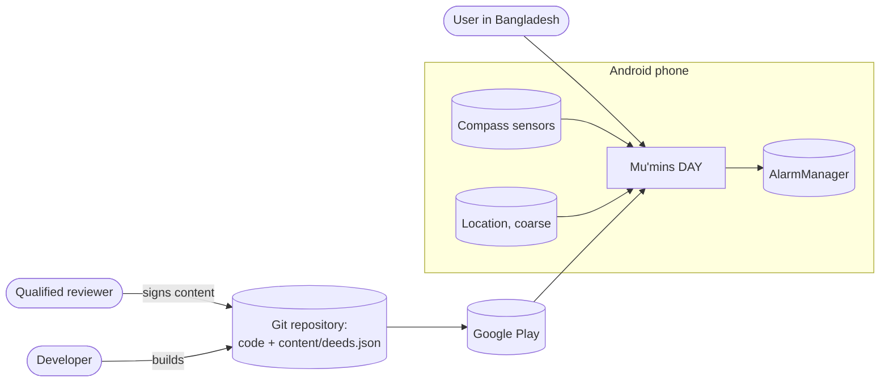
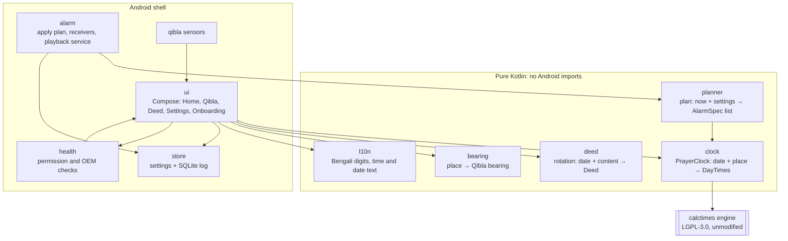
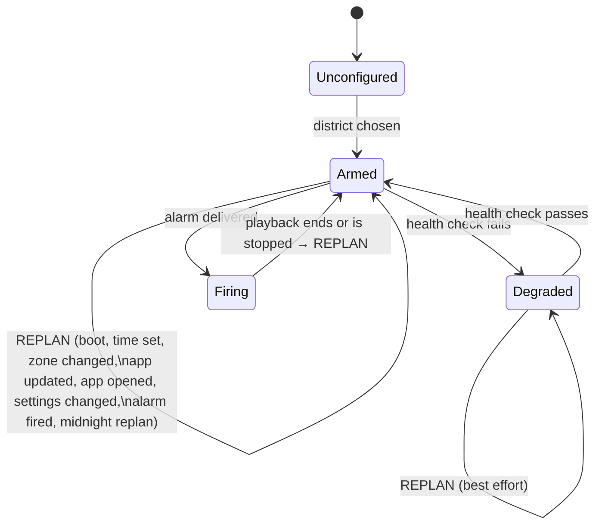

# 03 · Architecture

Labels and shorthand are as in `00-base-audit.md`. This file describes the design; it contains no application code.

**One sentence.** One Android app, one app module plus a plain Kotlin core (ADR-9), no backend, no network, with a pure core (time engine wrapper, alarm planner, deed rotation) and a thin Android shell around it.

## Context

There is no server box in this diagram, on purpose.

## Components

Rule: nothing in `pure` may import `android.*`. CI enforces it with a text check (no extra dependency).

## The time engine as a pure library

**Interface (described, not coded).**

- Input: `date`, `place` (latitude, longitude, fixed elevation, zone id), `settings` (Asr convention, per-prayer offsets in minutes, Sehri margin).
- Output: either `DayTimes` (sehriEnd, fajr, sunrise, dhuhr, asr, maghrib, isha, each an instant in the place's zone) or `NotComputable(prayer, reason)`.
- Errors are values. The wrapper never returns 00:00 for a failure (INV-T7; the engine does: KNOWN, `E/DoubleTimes.kt`).
- Method is fixed to Karachi (KNOWN present: `E/Method.kt`). Elevation comes from the district table, not GPS.
- The wrapper passes user offsets through the engine's own per-prayer minute fields (KNOWN to exist: `E/Method.kt`), so there is one offset mechanism, not two as in the base (audit §2).

**Property tests.** Random dates across 2020-2040 and random points in Bangladesh's bounding box:

1. Order: `sehriEnd ≤ fajr < sunrise < dhuhr < asrShafi < asrHanafi < maghrib < isha` (INV-T1).
2. `iftar == maghrib`; `sehriEnd == fajr − margin` under the agreed rounding (INV-T2, INV-T5).
3. Determinism: result is identical whatever the JVM default zone and locale (INV-T3).
4. Offset linearity: offset N on one prayer shifts only that prayer by N (INV-T6).
5. Continuity: from one day to the next, no time moves by more than 3 minutes **(target)**; catches date and zone slips.
6. Zone stability: converting results to UTC gives the same instants whether the device zone is Asia/Dhaka, UTC or America/New_York.

**Fixture tests.** A committed table of the reference timetable for eight cities × 365 days (INV-T4). Source is Q2.

## The scheduler as a state machine

**The base's model** is "one alarm, each fires and sets the next" (KNOWN, audit H4). **The new model** is "always hold the next 24 hours; replan on every trigger".

**Pure part: `plan(now, settings) → AlarmSpec[]`.** Each spec has a stable id, an instant, a kind (adhan · tone · silent · pre-reminder · replan) and a prayer. The plan always includes every enabled prayer in `[now, now + 24 h]` plus one `replan` spec shortly after local midnight. Being pure, it is tested without a device (INV-S2).

**Android part: `apply(plan)`.** Cancel every id in the fixed id space, then register the plan. The id space is small and closed (4 day-slots × 16 kinds = 64 ids; id = `epochDay mod 4` × 16 + kind slot, so the same alarm keeps its id across replans), so "cancel all, set all" is cheap and makes scheduling idempotent (INV-S4).

**Events that trigger REPLAN.** Boot completed; time set; time-zone changed; my-package-replaced; exact-alarm permission state changed; app brought to foreground; any settings change; any alarm delivered; the midnight replan alarm. The base handles the first three and app start only (KNOWN, audit §3).

**Persisted.** Settings (district, offsets, per-prayer mode, silent-mode choice). The alarm log (planned instant, delivered instant, outcome), trimmed to 30 days. **Not persisted:** the plan itself. It is always recomputed, so it cannot go stale.

**Health check → Degraded reasons, each with its own message and one-tap fix.**

| Reason | Detected by | Label |
|---|---|---|
| Exact alarms not allowed | `canScheduleExactAlarms()` | KNOWN API (alarms doc) |
| Notifications blocked | Notification manager state | ASSUMED API |
| Battery optimisation applies to the app | `isIgnoringBatteryOptimizations` | KNOWN, used in `A/times/utils/BatteryOptimizations.kt` |
| An alarm in the last 7 days was delivered more than 2 min late, or never | The alarm log | Own design |
| Manufacturer known for killing apps, and the user has not confirmed the per-brand steps | `Build.MANUFACTURER` | ASSUMED |

**Delivery.** Adhan alarms use `setAlarmClock`, as the base does by default (KNOWN, `A/MyAlarmManager.kt`); the platform documents it as leaving low-power modes to deliver (KNOWN, alarms doc). Silent and pre-reminder alarms use `setExactAndAllowWhileIdle`. On delivery the app starts a `mediaPlayback` foreground service, as the base does (KNOWN, `AlarmService.kt`), holds a wake lock for the length of the recording plus a margin, plays, logs, replans.

**How each Phase 2 failure mode is handled.**

| F1 # | Handling |
|---|---|
| 1 Doze | `setAlarmClock` |
| 2 OEM killer | 24-hour window means one lost process does not break the chain; log exposes misses; per-brand onboarding |
| 3, 12 Exact permission | Degraded state with visible warning; replan on permission-state broadcast |
| 4 Notifications blocked | Degraded state; playback does not depend on the notification (ASSUMED; verify) |
| 5 No location | Stored district only |
| 6, 7 Spoof / travel | Ask before changing district |
| 8 Zone mismatch | Planner works in the place's zone (INV-S2) |
| 9, 10, 11 Clock, boot, update | REPLAN events |
| 13 Midnight | Planner works on instants, not on "today's list"; no hour heuristic |
| 15, 16 Silent, call | Decided at delivery from the user's one setting and audio-focus state |
| 17 Late | INV-S7 rule at delivery |

**What cannot be guaranteed, and how the user is told.**

- **Force stop.** Nothing runs until the app is opened (ASSUMED platform behaviour). Onboarding states it once.
- **OEM "autostart" disabled.** After a reboot the app may not be allowed to start (KNOWN for Xiaomi, dontkillmyapp.com; other brands UNKNOWN). The Reminder-health screen shows the miss the next time the app is opened and repeats the brand steps.
- **Before first unlock after reboot.** UNKNOWN whether alarms set from a direct-boot receiver are worth the complexity. Measure on the matrix first; default is not to support it.
- **`setAlarmClock` side effect.** The system may show an alarm icon and treat the next Adhan as the phone's "next alarm" (ASSUMED). If users object, the fallback is `setExactAndAllowWhileIdle` for all kinds, with weaker Doze guarantees. Decide on device evidence.

## Data layer

| Data | Where | Why |
|---|---|---|
| Settings | Platform SharedPreferences, one file, versioned keys | Small, no dependency |
| Alarm log, deed completions | One SQLite database through the platform's own helper, two tables | No dependency; SQLite is what Quran search will need later |
| Quran text, metadata, font | `content/quran/` staged byte for byte into `assets/quran/` (ADR-23); hashes in `content/quran-SOURCES.md`, checked by T-BUILD-6 and again on the phone | Verbatim by licence (INV-QT1) |
| Quran search | `quran.db`, built on the phone from the verified assets, FTS4, never backed up (ADR-23) | No build-time SQLite library |
| Deeds | `content/deeds.json`, packaged as an asset, parsed with the platform JSON parser | Reviewer-editable, diffable |
| Districts | `content/districts.json` asset: id, names (bn, en), latitude, longitude, elevation | 64 rows |
| Adhan audio | One file in `res/raw` | License: Q5 |

**Schema.** `alarm_log(id, prayer, kind, planned_utc, delivered_utc NULL, outcome)`; `salah_log(local_date, salah, prayed_at, PRIMARY KEY (local_date, salah))` in `deed-days.db`, migration 2 (ADR-18); `khatam(id = 1, started_on, target_on, end_ayahs, position, marked_on, day_start)` in `deed-days.db`, migration 3, one row at most (ADR-24); `deed_day(local_date PRIMARY KEY, deed_id, content_version, swapped, done_at NULL)` (was `deed_done`; one row per day the card was shown, amended 2026-11-26, G5). **Migrations.** Numbered SQL files applied in order; a test opens each historical schema and migrates to current.

**Backup.** Settings, deed completions, the Salah log and the khatam plan (same file, ADR-18, ADR-24) may be included in Android's backup; the alarm log is excluded. After a restore the health check runs (failure mode 12). Exact backup-rule syntax: UNKNOWN here, take from Android docs.

**Size budget (targets).** Code and resources ≤ 6 MB, audio ≤ 2 MB, content ≤ 0.1 MB, total download ≤ 15 MB. Actuals: UNKNOWN until the first build.

**Bundled vs downloaded.** v1: everything bundled, nothing downloaded. Phase 16: packs (tafsir, recitation audio with optional verse timings) are downloaded into `filesDir/packs/<id>/`, outside every backup rule, listed by the bundled `assets/packs/manifest.txt` (empty) and used only when each file's SHA-256 matches it (ADR-25). Nothing can be downloaded today: no host, no `INTERNET`.

## Localization architecture

| Topic | Decision | Label |
|---|---|---|
| Default locale | Bengali strings live in the default `values/` folder; English in `values-en/`. A phone in any other language sees Bengali. A per-app language setting offers বাংলা / English | Design choice; per-app locales are KNOWN supported by the base (`locales_config.xml`) |
| Completeness | Build fails on any key missing in either language (INV-L1) | The base's 37 % Bengali coverage is the cautionary case (audit H2) |
| Digits | One pure function maps 0-9 to ০-৯ for all numbers shown in Bengali; property-tested over all ten digits. The base's version skips 9 and has no Bengali (KNOWN, `LocaleUtils.kt:225`) | Design choice |
| Time format | 12-hour with Bengali day-part words (ভোর, দুপুর, বিকাল, সন্ধ্যা, রাত) as the default; 24-hour as an option. Wording to be confirmed with native speakers | ASSUMED preference; test with users |
| Dates | Gregorian date in Bengali. Bengali-calendar and Hijri dates are **not** in v1 | Cut; Hijri needs the ±1 decision |
| Plurals | Android plural resources for every counted phrase, even where Bengali uses one form | ASSUMED Bengali has one/other forms only; verify in CLDR |
| Arabic inside Bengali/English | Wrap every Arabic run in Unicode directional isolates through the platform's bidi helper | ASSUMED API |
| Fonts | Start with system fonts. Check Bengali conjuncts and Arabic diacritics on every phone in the matrix. Bundle a font only if a phone fails | UNKNOWN until tested; a bundled Bengali font costs install size (amount UNKNOWN) |
| Text expansion | Layouts sized for the longer of the two languages at 200 % font scale (INV-L4) | |
| Translation process | Bengali is written first by a native speaker, not machine-translated from English. No Crowdin in v1: two languages do not need it | Cut |

## Privacy architecture

**Permission allowlist. The build fails if the merged manifest differs (INV-P3).**

| Permission | Reason shown to the user |
|---|---|
| `USE_EXACT_ALARM` (Android 13+) and `SCHEDULE_EXACT_ALARM` (Android 12) | Ring the Adhan at the exact time. See ADR-4 |
| `RECEIVE_BOOT_COMPLETED` | Set the alarms again after a restart |
| `POST_NOTIFICATIONS` | Show the prayer notification |
| `FOREGROUND_SERVICE`, `FOREGROUND_SERVICE_MEDIA_PLAYBACK` | Play the Adhan |
| `WAKE_LOCK` | Keep the phone awake while the Adhan plays |
| `ACCESS_COARSE_LOCATION` | "Find my district": read once, only while the district screen is open, never stored (ADR-19) |

Removed relative to the base (KNOWN list, audit §3): `INTERNET`, `ACCESS_NETWORK_STATE`, `ACCESS_FINE_LOCATION` (the app declares coarse only), `DISABLE_KEYGUARD`, `ACCESS_NOTIFICATION_POLICY`, `FOREGROUND_SERVICE_SPECIAL_USE`, `SET_ALARM`, `INSTALL_SHORTCUT`.

**Network allowlist.** Empty. `INTERNET` is not declared (INV-P1). A CI check greps the merged manifest. The pack downloader exists (phase 16, ADR-25) with one host constant, `PACK_HOST` in `app/.../packs/PackHost.kt`, which is empty; `network_security_config.xml` refuses cleartext for every host. `INTERNET` and a host arrive together in one commit (ADR-25).

**Crash reporting.** None automatic. A "Send a report" button in Settings opens the user's email app with a plain-text draft they can read: app version, Android version, manufacturer and model, health-check results, the 7-day alarm log. No identifiers. The user chooses whether to send. This is the only way information leaves the phone, and it does not need the `INTERNET` permission.

**Location.** The app reads the phone's position only when the user taps "Find my district" on the district screen, once, while that screen is open, with `ACCESS_COARSE_LOCATION` and nothing finer (ADR-19). The position is turned into the nearest district at once and discarded; only the chosen district id and its centre's coordinates are stored. A position outside Bangladesh's bounding box or more than 50 km from every headquarters point is shown with a warning and needs a second tap; no case switches the district without a tap. The district list can always be used by hand.

**Vibration.** Not used and not declared (ADR-12). Adding `VIBRATE` back needs an ADR.

## Dependency policy

Default answer is no. Allowlist (INV-P4):

| Dependency | License | Why it exists | Cost of removing |
|---|---|---|---|
| Kotlin stdlib | Apache-2.0 (ASSUMED) | Language | Not removable |
| `calctimes` engine | LGPL-3.0 (KNOWN) | Prayer time calculation | ADR-2 |
| `kotlinx-datetime` | Apache-2.0 (ASSUMED) | Required by the engine's API (KNOWN, `calctimes/build.gradle.kts`) | Goes if the engine is replaced |
| Jetpack Compose + Material 3 + Activity | Apache-2.0 (ASSUMED) | UI | A rewrite in Views; more code, not less |
| Test only: JUnit, a property-testing library (the base already uses Kotest: KNOWN) | (ASSUMED permissive) | Tests | None shipped |

Sizes: UNKNOWN until built. Verify every license from the generated dependency report before release.

**Explicitly refused:** Ktor, Ion, Room, WorkManager, DataStore, a DI framework, a navigation library, an image loader, Sentry or any crash SDK, Firebase, Google Play services, kotlinx-serialization, AboutLibraries, Flexmark. Each solved a problem v1 does not have.

## Build, release, update

- **Signing.** Play App Signing with an upload key kept offline and backed up. (Process details: take from Play Console at setup.)
- **Flavours.** None. One build.
- **Application id.** New and unrelated to `com.metinkale.prayer`.
- **Versioning.** `versionName` = `major.minor.patch`; a separate integer `contentVersion` for deeds.
- **Rollout.** Closed test with ≥ 12 testers for 14 days (KNOWN requirement), then staged production rollout at increasing percentages **(targets: 10 → 50 → 100 %, holding 48 h each)**, watching the "Send a report" inbox and Play's own vitals.
- **Content updates without code.** A content change touches only `content/*.json` and the reviewer's note, and ships as an ordinary app update. No Kotlin changes, no feature flags. Over-the-air content waits for the Quran work.
- **Store listing.** Bengali first, English second; screenshots from the redesigned UI only; no upstream assets.
- **Attribution.** A `NOTICE` file and an in-app "Open-source licences" screen credit prayer-times-android (Apache-2.0) for any ported code, and reproduce the engine's LGPL notices (KNOWN required by `calctimes/NOTICE.txt` and `open-prayer-times/README.md:65-72`).

## Forward path

| Later feature | Where it attaches | What v1 must not do |
|---|---|---|
| Quran, tafsir, audio | `core/packs` (manifest, host, resume, hash, download state, timings) and `app/.../packs` (downloader, files, one worker per tapped download), built phase 16 without `INTERNET` (ADR-25). Adds `INTERNET`, for one host, only when ADR-25's conditions are met | Must not scatter storage across files and preferences |
| Duas, daily hadith | Same content record shape and review gate as deeds | Must not hard-code "deed" into the gate |
| Salah tracker | A table in the backed-up user-data file (`salah_log`, ADR-18); a "Prayed" action on the notification the alarm component already posts (built phase 10) | Must not let notifications be built in more than one place |
| Hijri, ±1 day | The engine repo's `hijri` module (Apache-2.0, KNOWN) behind the `clock` interface | Must not format dates outside `l10n` |
| Widgets | Read the planner's output (`core/widget`, built phase 10) | Must not let UI compute times itself |
| Paid tier | A single `entitlements` interface that returns "everything" in v1 | No billing code, no stubs beyond the one interface |
| Sync / accounts | Not planned. If ever: export/import of one file first | No account concepts in v1 |

---

## Decision records

### ADR-1 · New app that ports parts, not a pruned fork

- **Context.** The audit's deletion list removes most modules, both flavours' extras, all networking and 49 languages (audit §10). State is spread over SharedPreferences and static singletons (`A/times/times/TimesCompanion.kt`, `A/App.kt`), the scheduler has no tests, and upstream asks for a real redesign (`README.md:159-161`). Play disallows apps that merely replicate existing ones (KNOWN).
- **Options.** (a) Fork and delete down. (b) Start an empty project; port the engine call, the Qibla bearing maths and sensor filter, and the proven alarm delivery pattern, with attribution.
- **Decision.** (b).
- **Consequences.** More typing in week one. Far less inherited behaviour to understand. Upstream fixes no longer merge; they are read and ported by hand. Clear answer to both the author's request and the Play policy.
- **Reverse.** If slice 1 takes more than two weeks **(target)**, fall back to (a) using `00-base-audit.md` §10 as the deletion script.

### ADR-2 · Keep the LGPL engine, unmodified, behind an interface

- **Context.** `calctimes` is LGPL-3.0 (KNOWN). It is pure, already has Karachi and Hanafi, and is what the reference app ships.
- **Options.** (a) Use it unmodified as a separate library and comply with LGPL. (b) Replace it with a permissively licensed engine (candidates and their licenses: UNKNOWN, not researched in this run). (c) Write a new implementation from published astronomical formulas.
- **Decision.** (a) now. Do not modify the engine; if a change is ever needed, publish it. Get a written legal opinion on LGPL compliance in a Play-distributed app before any paid tier (Q6).
- **Consequences.** Licence notices in the app. A legal question stays open. No engine work in v1.
- **Reverse.** The `clock` interface plus the fixture table make a swap mechanical: any engine that passes T-FIX-4 and the property tests is acceptable.
- **Amended 2026-11-26 (founder decision, gap G1).** "Unmodified" could not stand. The engine's public output is already rounded, with Fajr rounded down, and it turns a failed calculation into 00:00 (KNOWN, `DoubleTimes.kt` at `a136f9b`), so INV-T5 and INV-T7 cannot be met from outside it. The engine is now **vendored at `engine/calctimes/` with one change**: `DoubleTimes` and `CalcTimes.getDoubleTimes` are public. The change is recorded in `engine/calctimes/MODIFICATIONS.md`. LGPL duty that follows: the modified engine source must be offered to anyone who gets the app; a public repository containing `engine/calctimes/` satisfies that (ASSUMED; part of Q6). Vendoring also closes G3: upstream publishes no artifact to depend on.

### ADR-3 · Hold a 24-hour window of alarms; recompute, never persist

- **Context.** The base holds one alarm and chains (KNOWN). One lost link silences the app until the next boot or app open, and its daily repair job needs internet (S1, S2).
- **Options.** (a) Keep the chain. (b) 24-hour window, replan on every event, cancel-all-then-set. (c) Schedule a week ahead.
- **Decision.** (b).
- **Consequences.** Up to about a dozen pending alarms instead of one. Losing any one costs one prayer, not all. (c) adds nothing: times drift daily and a replan happens daily anyway.
- **Reverse.** The planner's window length is one constant.
- **Amended 2026-11-26 (founder decision, gap G8).** The window is **48 hours**, not 24. With 24, a phone that freezes the app after the last alarm loses every reminder the same day, which is the base's failure delayed by a few hours. With 48 the user gets a further day of reminders, and a day in which opening the app once repairs everything. About twenty pending alarms instead of ten. "24 hours" elsewhere in this file and in `02` now reads 48.
- **Also decided 2026-11-26 (gap G16).** A prayer whose time has passed when the plan is made is skipped silently. An alarm is planned only if its instant is strictly after "now", so replanning while an alarm fires cannot ring it twice (INV-S5). A pre-reminder is 1 to 120 minutes, so it can never share an instant with its own prayer. Two different prayers' alarms may share an instant (a long pre-reminder landing on the previous prayer); both are planned and the shell plays them in order.

### ADR-4 · Exact-alarm permission

- **Context.** `USE_EXACT_ALARM` is granted at install and cannot be revoked, and is described for calendar and alarm-clock apps; `SCHEDULE_EXACT_ALARM` is user-granted, off by default on fresh installs targeting Android 13+, and revocable (all KNOWN, Android docs). Play requires that exact alarms be core functionality (KNOWN). Whether Play accepts an Adhan app under `USE_EXACT_ALARM`: UNKNOWN. The base declares both and is on Play (KNOWN it declares both; its Play review history is UNKNOWN).
- **Options.** (a) Declare both, as the base does. (b) `SCHEDULE_EXACT_ALARM` only, with a grant step in onboarding.
- **Decision.** (a), with the Degraded state and grant flow built regardless, so (b) is a manifest edit away.
- **Consequences.** Best reliability if accepted. A rejection costs one review cycle.
- **Reverse.** Remove one manifest line; the grant flow already exists.
- **Re-read 2026-11-27 (KNOWN, developer.android.com/about/versions/14/changes/schedule-exact-alarms and /develop/background-work/services/alarms).** The pages say an app targeting Android 13+ may declare "either" `SCHEDULE_EXACT_ALARM` or `USE_EXACT_ALARM`. They do not mention `maxSdkVersion` or declaring both, so the pairing stays ASSUMED. `USE_EXACT_ALARM` is "Granted automatically", cannot be revoked, and is "subject to an upcoming Google Play policy". On Android 12 and 12L the flow is: `canScheduleExactAlarms()`, then `ACTION_REQUEST_SCHEDULE_EXACT_ALARM`, then re-check in `onResume`; on `ACTION_SCHEDULE_EXACT_ALARM_PERMISSION_STATE_CHANGED` re-check and replan. Revocation stops the app and cancels its exact alarms. Built in `alarm/AlarmScheduler.kt`; the grant flow itself has not run (no API 31/32 device, T-INST-6).
- **Built 2026-11-26.** Both are declared; `SCHEDULE_EXACT_ALARM` carries `maxSdkVersion=32`, so Android 13 and later rely on `USE_EXACT_ALARM` alone (ASSUMED to be the recommended pairing; the alarms page read on 2026-11-26 does not state it). The machine-readable allowlists are `app/allowlist/permissions.txt` and `app/allowlist/dependencies.txt`; the tables in this file explain them, the files are what the build checks.

### ADR-5 · Platform storage only

- **Context.** v1 stores a handful of settings and two small tables.
- **Options.** (a) Room + DataStore. (b) SharedPreferences + platform SQLite helper.
- **Decision.** (b).
- **Consequences.** Hand-written SQL for two tables; no annotation processor, faster builds, two fewer dependencies.
- **Reverse.** Adopt Room when the Quran schema arrives, if hand-written SQL becomes the bottleneck.

### ADR-6 · No network in v1

- **Context.** The base sends coordinates to a server for city lookup (KNOWN, H5) and downloads sounds and data. The product promise is offline and private.
- **Options.** (a) Keep city search online. (b) Bundle 64 districts and one Adhan; declare no `INTERNET`.
- **Decision.** (b).
- **Consequences.** The privacy claim becomes checkable by anyone reading the permission list. Bangladesh only. No remote content fixes; a wrong deed needs an app update.
- **Reverse.** Add `INTERNET` with a one-host allowlist when content packs arrive.

### ADR-7 · No automatic crash reporting

- **Context.** The base's Play flavour sends crashes with a per-install id (KNOWN, H7). Mu'mins DAY's positioning forbids trackers, yet F1 cannot be perfected blind.
- **Options.** (a) Self-hosted crash collector, opt-in. (b) On-device log plus user-initiated email. (c) Nothing.
- **Decision.** (b), plus Play's built-in vitals, which need no SDK (ASSUMED).
- **Consequences.** Fewer reports, each with full consent and context. No server to run.
- **Reverse.** Add an opt-in collector later behind the same "Send a report" screen.

### ADR-8 · Coarse location, fixed elevation

- **Context.** The base requests fine location and feeds GPS altitude into sunrise and sunset (KNOWN, audit §2, §3).
- **Options.** (a) Fine location and live altitude. (b) Coarse location, snapped to a district with a fixed elevation.
- **Decision.** (b).
- **Consequences.** Times are stable from day to day and identical for neighbours, which is what a mosque timetable looks like. The error from coarse position is a small fraction of a minute across a district (ASSUMED; compute east-west spread per district and confirm ≤ 1 min, else subdivide).
- **Reverse.** Offer "use my exact position" as an advanced switch.

### ADR-9 · A plain Kotlin `:core` module beside the Android app

- **Date.** 2026-11-26. Founder decision (gap G18).
- **Context.** The one-sentence summary above says "one Gradle module". The pure core (clock, planner, deed rotation, bearing, l10n) has no Android imports by rule. Google's Maven host is unreachable from the cloud environment where much of the work is done, so an Android module cannot build there (KNOWN, `curl`, 2026-11-26); Maven Central can.
- **Options.** (a) One Android module; build only on the founder's machine. (b) `:core` as a plain Kotlin JVM module, `:engine:calctimes` as the vendored engine, `:app` as the Android shell added in slice 3.
- **Decision.** (b).
- **Consequences.** The "no `android.*` in pure code" rule is now enforced by the compiler, since `:core` has no Android on its classpath; the text check stays as a second guard against clock and locale reads. Core tests run in seconds on any machine. Three modules instead of one. "One Gradle module" in the summary now reads "one app module".
- **Reverse.** Move `core/src` into the app module; packages do not change.

### ADR-10 · The content gate is a build tool that parses with Gradle's own JSON reader

- **Date.** 2026-11-26. Founder asked for the T-BUILD-4 task; closes gap G24.
- **Context.** INV-C1 needs the build to fail on unreviewed content. `:core` holds the gate's rules but has no JSON parser and may not add one; the app will use the platform's. The build needs some parser.
- **Options.** (a) A JSON library as a dependency. (b) A hand-written parser. (c) `tools/content-gate`, a small module that is never shipped, reading the file with the Groovy JSON reader that comes inside Gradle (`localGroovy()`), then calling the core gate.
- **Decision.** (c).
- **Consequences.** Nothing is downloaded and nothing is added to the app, so the dependency allowlist (INV-P4), which governs what ships, is unchanged. The tool only reads the file's shape (types, unknown keys); every judgement about a record is `checkContent` in `:core`, the same function the app will call. Two parsers will read the same file, Gradle's at build time and the platform's on the phone; a file both accept could in principle be read differently, so the tool refuses anything but plain strings and whole numbers. The task passes with a notice while `content/deeds.json` does not exist; `-PdeedsRequired=true` makes absence a failure, and the app module must set it.
- **Reverse.** Replace the reader behind `runGate`; the rules do not move.

### ADR-11 · The UI is built with platform Views

- **Date.** 2026-11-27. Founder decision; closes gap G25.
- **Context.** The dependency allowlist is checked transitively (INV-P4) and the permission allowlist against the merged manifest (INV-P3). Compose and Material 3 would add dozens of transitive AndroidX libraries, and AndroidX core adds a permission of its own to the merged manifest.
- **Options.** (a) Compose and Material 3, with an ADR accepting the real transitive list. (b) Platform Views (`android.widget`, `android.view`), no Compose, no Material, no AndroidX.
- **Decision.** (b).
- **Consequences.** Neither allowlist grows: no new dependency, no new permission. Screens are written as plain Activity and View code with layouts and string resources; there is no navigation library (it was already refused). Bengali text, plurals and directional isolates come from platform resources and `:core`'s `l10n`. The cost is more code per screen and no ready-made components; the app stays small and its supply chain stays as short as it is today. Material components, if ever wanted, need a new ADR and the founder's yes.
- **Reverse.** Add Compose behind an ADR that accepts the transitive list and the permission it brings, then move screens one at a time.

### ADR-12 · No location and no vibrate permission

- **Date.** 2026-11-27. Founder decision (yes recorded for INV-P3).
- **Context.** The manifest declared `ACCESS_COARSE_LOCATION` and `VIBRATE`. No code uses either: the district is picked by hand and nothing calls a location or vibration API (KNOWN: `grep -rn -i "location\|vibrat" app/src core/src` finds only comments saying location is not used). A permission the app never uses invites a Play review question (ASSUMED).
- **Options.** (a) Keep both for a later feature. (b) Remove both now.
- **Decision.** (b). `app/allowlist/permissions.txt`, the manifest and the permissions table above now list seven permissions (KNOWN: gate output "permission gate: passed, 7 permissions, no INTERNET.", 2026-11-27).
- **Consequences.** A smaller privacy page and Play surface. ADR-8's "coarse location" is now only the coarse district centre the user picks; the app never asks the platform for a position. The in-app "find my district" idea is gone until a new ADR.
- **Reverse.** Add the line to the manifest and the allowlist, with an ADR and the founder's yes (INV-P3).
- **Superseded in part 2026-11-28 by ADR-19** for `ACCESS_COARSE_LOCATION`: it is back, for "find my district" only. `VIBRATE` stays removed.

### ADR-13 · The LGPL licence texts ship inside the app

- **Date.** 2026-11-27. Founder decision; closes G43 as far as the build goes (the legal reading stays Q6).
- **Context.** The engine jar's `META-INF/LICENSE` and `NOTICE.txt` are dropped when the APK is packaged, so the LGPL text was not in the APK (KNOWN: `05-licences.md` finding 1). LGPL-3.0 section 4(b) asks that the GPL and LGPL texts accompany the object code (KNOWN: quoted from `engine/calctimes/LICENSE`).
- **Decision.** `app/build.gradle.kts` task `stageLicenceTexts` copies, byte for byte, `engine/calctimes/LICENSE`, `LICENSE.GPL-3.0`, `NOTICE.txt` and the root `LICENSE` (Apache-2.0) into `assets/licences/` of every variant. The Licences screen shows them after the existing notices, as plain scrollable text. They are English in both languages and not run through the digit converter (legal text). They are assets, not `strings.xml`, so the string gate is unchanged.
- **Consequences.** About 54 KB of text added to the APK. The texts cannot drift from the repository files. KNOWN: the LGPL text was seen on the emulator, release build. The Bengali intro line "the full licence texts are in the files named below" still reads correctly; changing Bengali copy needs a native speaker.
- **Reverse.** Delete the task and the loop in `LicencesActivity`.

### ADR-14 · Core library desugaring removed

- **Date.** 2026-11-27. Founder approved trying it (INV-P4).
- **Context.** `minSdk` is 26, and `java.time` is in the platform from API 26 (ASSUMED, general knowledge). The desugaring library is GPLv2 with the Classpath Exception (KNOWN, its POM, `05-licences.md`).
- **Decision.** Removed `coreLibraryDesugaring`, `isCoreLibraryDesugaringEnabled`, the version-catalog entries and the two allowlist lines. Result: `./gradlew build --rerun-tasks` green with Android lint (warnings as errors, which includes the NewApi check) and the dependency gate "passed, 4 libraries" (KNOWN, 2026-11-27). `:core` uses `java.time` and `kotlinx-datetime`; nothing above API 26 was flagged.
- **Consequences.** The only GPL-family library leaves the app; four libraries remain (kotlin-stdlib, annotations, kotlinx-datetime and its jvm artifact). Whether any `java.time` call behaves differently on an API 26 device than with the library: UNKNOWN, no API 26 device was run; the emulator is newer.
- **Reverse.** Restore the four items listed above and the two allowlist lines.

### ADR-15 · R8 minification and resource shrinking for release

- **Date.** 2026-11-27. Founder decision.
- **Context.** Release was unminified. Manifest components are kept by AGP's generated rules; the app uses only platform APIs and `org.json`, which need no rules (ASSUMED, then tested).
- **Decision.** `release { isMinifyEnabled = true; isShrinkResources = true }`, no proguard file. **Correction 2026-11-28:** these two lines were not in `app/build.gradle.kts` at any commit (KNOWN, `git log -S`); the measurement above came from an uncommitted build file. Added on 2026-11-28: release APK 1,066,146 to 175,734 bytes; every manifest component is still in the dex; the release ships `assets/districts.json` with 64 districts. Not run on a device after this change. The release APK stays unsigned in the repo (signing is outside it).
- **Consequences.** KNOWN (2026-11-27): a copy signed with the debug keystore installed on the `streambert` emulator, launched, showed onboarding, Home, Settings, Qibla, the deed card, Reminder health and Licences with no `FATAL EXCEPTION`; `dumpsys package` listed `MainActivity` and `SystemEventReceiver`, and the dex still names `AlarmReceiver` and `PlaybackService`. For this test the signed copy had the debug district and deed files added, because the release build ships none yet. Not tested: an Adhan playing from a minified build (no audio check), a real phone.
- **Reverse.** Set both flags to false.

### ADR-16 · Times follow the Islamic Foundation: astronomy per district, plus the Foundation's own safety margins

- **Date.** 2026-11-28. Claude's decision under the founder's instruction to code all phases; **the reviewer must confirm** (Q2, Q3).
- **Context.** PLAN phase 1 said: "If the diff shows a steady bias, set default offsets". The first full reference arrived: the Islamic Foundation's permanent Dhaka timetable ("নামায ও রোযার স্থায়ী সময়সূচী"), a 2015 Word PDF mirrored at kivabe.com (KNOWN, SHA-256 `13ced531…0da7df`; the Foundation's own site did not answer). Its notes say Fajr, Dhuhr and Maghrib carry a 3-minute precaution and Sehri end is 3 minutes before true dawn. Measured against the raw engine at the Dhaka point (2025 to 2028, `IslamicFoundationTableTest`), table minus engine has a median of +3 on Dhuhr, +3 on Maghrib, +1 on Fajr and Isha, 0 on sunrise, -1 on Asr, and Sehri end -5 against the app's Sehri end: **the app let people eat about 5 minutes past the Foundation's Sehri end**, and put Iftar about 3 minutes before it.
- **Second finding.** For the other 63 districts the Foundation publishes Dhaka plus one fixed number of minutes per district. The same site's district pages for 28 Nov 2026, against the engine at each headquarters point, differ by latitude: the northern districts' sunrise is 8 to 10 minutes earlier and their Maghrib 8 to 11 minutes later than the sun does, the far south the reverse (G50). A fixed offset cannot follow the season, and the Foundation's own note says so. In summer the error reverses, which in the north would put the Foundation's Iftar before sunset (ASSUMED from the geometry; not measured, the site shows only today).
- **Options.** (a) Raw astronomy (as before). (b) Copy the Foundation exactly: Dhaka table plus its district offsets. (c) Astronomy for each district's own point, plus the Foundation's margins, derived from the Dhaka table.
- **Decision.** (c). `Calibration.islamicFoundation`: Fajr +2, Dhuhr +3, Maghrib +3, Isha +2, Asr 0, sunrise 0, Sehri end 6 minutes before Fajr. These are the smallest values for which, on every usable row over a leap cycle, the app is never more than 1 minute on the unsafe side of the Foundation for any prayer (Sehri end earlier, "may begin" later, sunrise not later). Result, table minus app: Sehri end -1 to +4, Fajr -4 to +1, sunrise -1 to +2, Dhuhr -1 to +1, Asr -2 to 0, Maghrib -2 to +1, Isha -2 to +1. The calibration is fixed in the app, not stored; the user's "matches my mosque" offsets start from 0 on top of it. `Calibration.none` remains for tests and as the reverse path.
- **Consequences.** Every default moved in the safe direction. In Dhaka the app now agrees with the Foundation within a minute on most rows; it is never more than a minute unsafe. Outside Dhaka the app will differ from mosque timetables that use the Foundation's flat district offsets, by up to about 10 minutes in the north and far south in late November. The app is the one following the sun there. Users can match their mosque with the per-prayer offsets. INV-T4's "within 1 minute" holds for Dhuhr only; for the other prayers the table's own spread over a leap cycle is wider than 2 minutes, so no single offset can meet it (KNOWN from the measurement). INV-T4 is a target and stays so.
- **Reverse.** Set the default to `Calibration.none`, or change the numbers; `IslamicFoundationTableTest` says at once whether the rule still holds.

### ADR-17 · Release order, the network, location, and the later features

- **Date.** 2026-11-28. Founder decisions, given in chat in reply to the part 2 plan: build all of phases 9 to 17; internet is allowed in the main app for downloadable packs only; "find my district" comes back with coarse location.
- **Context.** v1 is offline and has seven permissions (ADR-6, ADR-12). The founder asked for nine more features. The plan (`PLAN.md` part 2) bundles the small content (Quran text, duas, hadith) and downloads only the large (recitation audio, long tafsir).
- **Decision.**
  1. **Code order.** Phases 9 to 17 are coded in order, with unit tests beside each feature; the full verification pass (build, every gate, CI, emulator suite) is at the end. Nothing here ships before v1 (phases 7 and 8); the update after v1 is the founder's choice, suggested 10 to 12.
  2. **Network.** `INTERNET` arrives in phase 16 only, for pack downloads from one named host. It gets its own ADR then, a new allowlist line, a changed INV-P1 ("v1 makes no requests; the update makes requests only to the pack host, only when the user asks, and sends no identifier"), the privacy page and the Data safety form. Until phase 16 lands, INV-P1 and ADR-6 stand unchanged and the build gate still fails on `INTERNET`.
  3. **Location.** Reverses ADR-12 in phase 10 for `ACCESS_COARSE_LOCATION` only, with a new allowlist line then, read only while the "find my district" screen is open (INV-P2). Until phase 10 lands, the gate still lists seven permissions.
  4. **No dependency for any of it** is assumed: platform `AppWidgetProvider`, `SQLiteOpenHelper`, `Canvas` and `MediaPlayer` first (INV-P4). A need for one comes back as its own ADR.
  5. **Content.** Duas and hadith reuse the deed review gate, one task per kind, built when phase 13 needs the second kind (a generalisation with one user would be ceremony). The Quran has an integrity check instead of a review (INV-QT1). Claude writes none of the text; features are built on obviously fake records and the store build refuses to ship them (INV-C1, INV-C6).
  6. **Storage.** One user-data database `user-data.db` joins `alarm-log.db` and `deed-days.db` for tracker and khatam, with its own numbered migrations (ADR-5, G34 pattern, backup decided when it exists). **Amended 2026-11-28 (ADR-18): the tracker's table joins the existing `deed-days.db` as migration 2 instead; no `user-data.db` file is created for it.** Bundled Quran and hadith are read-only asset databases, never written, never backed up.
- **Size budget (ASSUMED until measured; target 15 MB total, INV constraint table).** Today: release APK 184,738 bytes (KNOWN, `STATE.md`). Adhan recording: not yet in. Allowances: Quran Arabic plus Bengali text 4 MB, Arabic font 1 MB, hadith 2 MB, duas 0.5 MB, one Adhan 1 MB, everything else 1 MB. Audio and tafsir are downloads and not counted. Each content phase measures its real size and updates this line. **Measured 2026-11-28 (phase 14, KNOWN: `ls -l` and `unzip -lv` of `app-release-unsigned.apk` from `./gradlew build`):** release APK 867,257 bytes, was 233,370 after phase 13, so phase 14 added 633,887 bytes. Of that, the compressed Quran assets are 612,262 bytes: Uthmani text 300,659 (1,396,087 raw), Simple Clean search text 218,904 (794,313 raw), metadata 12,906, Amiri Quran font 77,849 (136,920 raw, against the 1 MB font allowance), OFL 1,944. Arabic text, font and search text together are about 0.6 MB against the 4 MB text allowance; no translation is bundled. The search database is built on the phone, so it costs storage, not download (size on a phone: UNKNOWN, measure). **Measured 2026-11-28 20:24 +0600 (ADR-26, KNOWN: `ls -l` and `unzip -lv` of `app-release-unsigned.apk` from `./gradlew build --rerun-tasks`):** release APK 5,440,616 bytes, was 900,104 after phase 16, so the two translations and their code added 4,540,512 bytes. Compressed in the APK: Zakaria's 114 sura responses 3,933,814 bytes (30,607,538 raw, because QuranEnc's API escapes each Bengali character as six ASCII bytes) and Rowwad's XML 571,890 (3,402,353 raw). Quran Arabic plus Bengali text is now about 5.1 MB against the 4 MB allowance: **over the allowance by about 1.1 MB, still within the 15 MB total target**; Zakaria's escaped JSON is most of it (G66).
- **Consequences.** Three invariants and one gate row are new (INV-C5, INV-C6, INV-QT1, INV-H1, INV-Z1). The "no network" and "no location" promises stay true in every build until the phase that changes them lands, and each change is visible as a manifest and allowlist diff.
- **Reverse.** Drop the phase; the gates were never loosened before it.

### ADR-18 · The Salah log lives in `deed-days.db`, as its second migration

- **Date.** 2026-11-28. Claude's decision under the founder's instruction to build phase 10; the founder may reverse it.
- **Context.** ADR-17 item 6 planned a new `user-data.db` for the tracker and khatam. `PLAN.md` says the tracker is "backed up with deed days". Backup rules list files by name (G34), so a second backed-up file means a second `<include>` line in both rule files and a second place to forget one; renaming `deed-days.db` would orphan any backup already made (none exists yet: no release has shipped, KNOWN `STATE.md`).
- **Options.** (a) New `user-data.db`, include it in both backup rule files. (b) `salah_log` as migration 2 of `deedMigrations` in the existing backed-up file, rules unchanged. (c) Rename the file to `user-data.db` and move the deed table.
- **Decision.** (b). `deedMigrations` is now described as the backed-up user data's history. The file keeps its name `deed-days.db`. Khatam (phase 15) adds its own migration to the same list.
- **Consequences.** No change to `data_extraction_rules.xml` or `full_backup_content.xml` beyond a comment; `MigrationsTest` still proves both include `deed-days.db` and exclude the alarm log. One SQLite connection serves deeds and the tracker. Only marked prayers have rows, so the table cannot hold a count of prayers not marked (INV-C5). A restored backup brings the log back; nothing else reads it. The file's name no longer says everything it holds (cosmetic).
- **Reverse.** Move the table to a new file with a migration that copies the rows, and add the include line.

### ADR-19 · "Find my district" returns, with `ACCESS_COARSE_LOCATION` only

- **Date.** 2026-11-28. The founder's yes for INV-P3 is recorded in ADR-17 (item 3); this is the decision that carries it out.
- **Context.** ADR-12 removed the permission because no code used it. The founder asked for the button back (ADR-17). F1 #6 and #7 already say what it must do with a position outside Bangladesh and that the app never switches silently.
- **Options.** (a) Fine location with GPS. (b) Coarse location through the platform `LocationManager`, one read. (c) A location library (Play services): refused, INV-P4 and ADR-6.
- **Decision.** (b). `ACCESS_COARSE_LOCATION` is in the manifest and `app/allowlist/permissions.txt` (eight permissions). Two `uses-feature` lines mark location hardware as not required, so no phone is filtered out of Play (they are not permissions). The permission is requested at the tap on the button and never at start. `OneShotLocation` reads once (`getCurrentLocation` from API 30; `requestSingleUpdate` before it), from the fused provider (API 31) or the network provider, with a 20 second limit, and is stopped in `onPause`. `core/districts/Nearest.kt` picks the nearest headquarters point by great-circle distance. Every result needs a tap; a position outside the bounding box or more than 50 km from every point (F1 #6) is shown in a warning panel with "use it anyway".
- **Consequences.** The Data safety and privacy drafts change (`06`). A denied permission, a switched-off location or a phone without a network provider shows a sentence and leaves the list of districts, which always works. Not verified on a device: the system permission dialog, the provider choice, the 20 second limit, `T-INST-11` (no request while backgrounded). Older phones (API 26 to 29) use a deprecated call whose replacement needs API 30.
- **Reverse.** Delete the button, `OneShotLocation.kt`, the manifest lines and the allowlist line; ADR-12 stands again.

### ADR-20 · The Hijri date is calculated by the tabular rule, not vendored, and never shown as an announcement

- **Date.** 2026-11-28. Claude's decision under the founder's instruction to build phase 11; the founder may reverse it.
- **Context.** INV-H1: a Hijri date names its rule and the user can move it a day. Bangladesh's month starts follow an announcement (KNOWN: the National Moon Sighting Committee met at the Islamic Foundation's Baitul Mukarram National Mosque and announced Ramadan 1447 for Thursday 2026-02-19, Dhaka Tribune 2026-02-18, https://www.dhakatribune.com/bangladesh/403655/holy-ramadan-begins-on-thursday). Which body decides for the app, and whether the app ever holds announcements, is not decided (Q10, G54).
- **Options.** (a) Vendor upstream's `hijri` module (cloned and read 2026-11-28 from https://github.com/metinkale38/open-prayer-times at `0db43f9`, Apache-2.0 per its POM). Its default data is a Diyanet (Turkey) month-start table in `hijri.tsv` (KNOWN: header and rows read, 1433 to 1457 AH), a different authority from Bangladesh's, and its other mode is the JDK's `HijrahChronology`, whose Android behaviour is not the JVM's (ASSUMED). (b) A small pure implementation of the tabular civil calendar in `core/hijri`, about 60 lines. (c) Wait for the authority.
- **Decision.** (b). Nothing is vendored, so `NOTICE` and `MODIFICATIONS.md` do not change. The rules are those published at https://en.wikipedia.org/wiki/Tabular_Islamic_calendar (read 2026-11-28); the day-count formulas are the usual ones for that rule, and the tests check the month lengths and the 30-year leap pattern against the published rule rather than against the formulas. The only `HijriRule` is `CalculatedTabular`; an `Announced` case is deliberately absent until the authority is decided, so a calculated date cannot be passed off as an announcement. The day changes at Maghrib (ASSUMED convention, reviewer to confirm); where Maghrib cannot be computed it changes at midnight and no time is invented (INV-T7). The adjustment (-1, 0, +1) is a closed enum kept in `AppPrefs`, so it is backed up with the settings.
- **Consequences.** Measured: the tabular date is up to 2 days from the JDK's Umm al-Qura calendar over 1980 to 2070 (`HijriTest`, probe line `HIJRI-PROBE`), and one day from the one Bangladesh announcement tested (calculated 1 Ramadan 1447 is 2026-02-18, announced 2026-02-19). So a one-day move is not always enough to match an announcement. Home shows the date, the rule in words and where to move it; Ramadan mode is only suggested in the calculated month of Ramadan and still waits for the tap (G33).
- **Reverse.** Replace `calculatedHijri` and `gregorianOf`; the types, the adjustment and the screens do not change. Adding `Announced` is a compile error in each `when` that must handle it.

### ADR-21 · Zakat rules are a signed data file; the calculator holds none; amounts round to the obligation's safe side

- **Date.** 2026-11-28. Claude's decision under the founder's instruction to build phase 12; the founder may reverse it.
- **Context.** INV-Z1: every rule (nisab basis, rate, conversions) comes from a file the reviewer signed; Claude writes no religious content (INV-C1 spirit). The reviewer does not exist yet (G9), so the app must be buildable and testable without the file.
- **Decision.** (1) `content/zakat-rules.json` carries: reviewer, review date, `status` (`approved` or `draft`), `test_fixture`, `nisab_basis` (gold or silver), the nisab in grams of each metal, `rate_percent`, `grams_per_bhori`, `ana_per_bhori`, `ratti_per_ana`, `conversion_source`, `wealth_counted` (cash, gold, silver, other), `deduct_debts`, `requires_hawl`, `notes`. Numbers are JSON strings so no float touches them. `core/zakat` parses nothing itself: the gate (Groovy) and the app (`org.json`) read the file into `RawZakatRules` and `checkZakatRules` judges it, once, the same way in both (parse at the edge, as for deeds). (2) `tools/content-gate` gains `checkZakatRules` (absent file passes with a notice, as deeds do; `-PzakatRulesRequired=true` for a store build; a `test_fixture` file is refused) and `checkDebugZakatRules` for the FAKE fixture `app/src/debug/assets/zakat-rules.json` (every number invented, `test_fixture: true`, the screen shows a banner). (3) A test reads the package source and fails on any number other than 0, 1, 2, 30 and 100, which are identities, the paisa, the digits kept in a division and the notation of a percent. (4) Rounding, safe side: a weight is converted with divisions that round up, the nisab's value with a division that rounds down, the amount rounds up to the paisa, so no rounding ever lowers what is owed or hides a reached nisab; "reached" means at least the nisab (ASSUMED reading, reviewer to confirm). (5) The screen stores nothing: no save, no database, no preference.
- **Consequences.** Until the reviewer signs the file a release shows "no signed rules" on the Zakat screen and calculates nothing. Debug builds show the fixture with a TEST RULES banner. What counts as wealth, whether debts come off, whether a year must pass and whether the nisab is gold or silver are all the reviewer's answers in the file (Q11, G55).
- **Reverse.** Delete `core/zakat`, the gate tasks, the screen and the Home button.

### ADR-22 · Duas and hadith: one provenance check, a reviewer's list of books, one rotation, no new notification

- **Date.** 2026-11-28. Claude's decision under the founder's instruction to build phase 13; the reviewer and founder must confirm items 2, 4 and 5.
- **Context.** ADR-17 item 5 deferred the generalised gate to the second kind. Deeds allow two books, a closed enum (`SourceBook`); which books duas and hadith may cite is a religious judgement Claude may not make (INV-C1). The deed gate's tests must stay unchanged, and they pin the deed's `checkProvenance` signature and the deed `Field` enum (an exhaustive `when` in `GateTest`).
- **Decision.** (1) The provenance rules live once, in `checkProvenanceOf(version, raw, book)` in `core/deed/Provenance.kt`, generic over the kind's book type; the deed's `checkProvenance` is now that function with v1's two-book enum, so deed behaviour and tests are unchanged. `core/content` holds `ContentKind` (Dua, Hadith), one key table read by both parsers, `checkKind`, and the typed `Reviewed` record with a sealed `Body` (dua: Arabic, transliteration, Bengali, English, occasion; hadith: Arabic, Bengali, English). Both kinds also carry number, edition, grading, reviewer, review date and status, as INV-C6 asks. (2) **Allowed books are the reviewer's data**: each file has a `sources` list, and a record citing a book outside it is refused (`NotInSources`). No book name is in any code. (3) Each file states `test_fixture`; the gate for `content/` refuses `true`, and the app accepts a fixture only in a debug build. Texts may not contain directional controls (U+202A to U+202E, U+2066 to U+2069), so the isolate the screen adds (INV-L3, `l10n.rightToLeft`) cannot be closed early. (4) Rotation is one helper, `content/pickForDay` and `alternateForDay`, now also used by `deedFor` and `alternateFor`; each kind needs 30 approved records like deeds (`MIN_APPROVED`, ASSUMED to suit; the reviewer may ask for another floor). The day's dua or hadith is **not stored**, so a content update during a day can change it (G56). (5) **No per-kind nudge.** At most one content notification a day stays the existing deed nudge; duas and hadith add no notification. (6) Gate tasks `checkDuaContent`, `checkHadithContent` (absent passes with a notice; `-PduasRequired=true`, `-PhadithRequired=true` make absence fail) and `checkDebugDuaContent`, `checkDebugHadithContent` over the FAKE fixtures; the release build stages `content/duas.json` and `content/hadith.json` when they exist. One screen, `TodayActivity`, reached from Home.
- **Consequences.** A release shows "not in this version yet" for both kinds until the reviewer delivers files. The reviewer's `sources` list is checked only for spelling consistency, not for which books are acceptable: that is the reviewer's signature, as the grading is. Long texts have no length limit (deeds have 90 code points); the screen scrolls.
- **Reverse.** A closed list of books per kind is one function passed to `checkProvenanceOf`; storing the day's record is a table in `deed-days.db` (ADR-18 pattern).

### ADR-23 · The Quran ships as Tanzil's verified text files; the search database is built on the phone with FTS4

- **Date.** 2026-11-28. Claude's decision under the founder's instruction to build phase 14; the founder may reverse it.
- **Context.** INV-QT1: the text ships byte for byte and the build fails on a hash mismatch. `PLAN` asked for a read-only SQLite asset built at build time. Building SQLite on the JVM needs a JDBC driver (for example `org.xerial:sqlite-jdbc`), which is a new dependency, refused by default (INV-P4, CLAUDE.md), even though it would not ship. Android API 26 runs SQLite 3.18 (KNOWN, https://developer.android.com/reference/android/database/sqlite/package-summary, table read 2026-11-28) built with `-DSQLITE_ENABLE_FTS3 -DSQLITE_ENABLE_FTS4` and no FTS5 (KNOWN, AOSP `platform/external/sqlite/+/refs/tags/android-8.0.0_r1/dist/Android.mk`, fetched 2026-11-28). Tanzil's terms, read 2026-11-28, permit verbatim redistribution in any application with the source indicated and a link to tanzil.net (quoted in `content/quran-SOURCES.md`).
- **Options.** (a) A build-time JDBC driver to make `quran.db` an asset. (b) Ship the verified text files as assets and build the database on the phone with the platform `SQLiteOpenHelper` on first open. (c) No database: search in memory.
- **Decision.** (b). `content/quran/` holds the Tanzil Uthmani text (displayed), the Tanzil Simple Clean text (indexed only, so a word typed in ordinary spelling finds the ayah), the Tanzil metadata (ayah counts, Arabic surah names) and the Amiri Quran font with its OFL, all as downloaded. `:tools:content-gate:checkQuranText` (T-BUILD-6) checks each SHA-256 against `content/quran-SOURCES.md`, refuses any unrecorded file, refuses a `translation-*` file without a `permission` line naming a file in `content/`, refuses a fixture translation, and checks the texts against the metadata (114 surahs, 6236 ayahs); `:app:stageQuran` depends on it, so no build that packages the text can skip it. The build writes the recorded hashes into `BuildConfig.QURAN_HASHES`; on the phone `openQuran` hashes every asset on every open and shows nothing if one differs. The database (`quran.db`, `quranMigrations`) is rebuilt when the assets' hashes change; after writing, it reads every ayah back and rolls back unless all 6236 equal the asset's text. The index is FTS4 with the `simple` tokenizer over words made by `quran.indexWords` (Arabic marks, tatweel and small letters removed, alef forms folded, for the index and the query only). `quran.lookup` reads "2:255" in ASCII, Bengali or Arabic-Indic digits, a surah number, or words (each a quoted prefix term, all required). No translation ships; debug builds generate a FAKE one (`translation-test.txt`, first line `# test_fixture`, "TEST TRANSLATION s:a"). The reader remembers the first ayah on screen in `AppPrefs.quranPosition` (backed up with the settings). The database is not in the backup rules.
- **Consequences.** No new dependency or permission. The first open on a phone parses about 2.2 MB of text and writes 6236 rows plus the index; how long that takes on a low-end phone is UNKNOWN (measure; the screen says it is preparing). The FTS SQL and queries were run by hand on desktop SQLite 3.54.1 with the real text (round trip byte-equal, a two-word search from 2:255 finds it in both texts); on Android's SQLite 3.18 they have not run. Bengali or English search works only when a translation exists (none in a release). A displayed text is never passed through the normaliser. The terms' "a link is made to tanzil.net": the app has no internet, so the address is shown as text on the reader and the Licences screen (Q13).
- **Reverse.** (a) can replace the on-phone build behind `openQuran` without changing the reader; the assets and the gate stay.
- **Amended 2026-11-28 by ADR-26:** two translations ship; the FAKE debug translation, its generator and its banner are deleted; the index is split into `arabic_index` and `translation_index` (migration 2).

### ADR-24 · The khatam plan counts ayahs, lives in `deed-days.db`, and rides on the one daily nudge

- **Date.** 2026-11-28. Claude's decision under the founder's instruction to build phase 15; the founder may reverse it.
- **Context.** `PLAN` phase 15 asked to decide the unit (juz, page or ayah), to keep a plan and its progress in one migration, to recompute the portion every day without "behind" language (INV-C4), and to allow one optional reminder through the existing nudge path only. The bundled Tanzil metadata (`content/quran/quran-data.xml`, hash-checked by T-BUILD-6) gives each surah's ayah count, 30 `<juz>` starts and 604 `<page>` starts (KNOWN, read in the file: `<juz index="2" sura="2" aya="142" />`; `grep -c '<page '` = 604). A page is a printed edition's (Madani) division and differs between editions people hold in Bangladesh (ASSUMED); a juz is 30 unequal parts, too coarse for a plan of, say, 45 days.
- **Options.** (a) Juz: 30 units, a plan length that is not a divisor of 30 cannot be even. (b) Page: 604 units, but the pages are one edition's. (c) Ayah: 6236 units, exact for this text in every edition; shown as surah:ayah ranges.
- **Decision.** (c). `core/khatam`: `AyahIndex` (ayahs from 1:1), `AyahRange`, `QuranLayout` built by `buildLayout` from the metadata's surahs and its juz starts (`parseJuzStarts` in `core/quran`), which turns an index into surah:ayah and names the juz a portion starts in (shown, never used to divide). `khatamToday(plan, today)` is pure and recomputed on every call: what is left from the start of today, shared over the days from today to the target, both included, rounded up, so following the plan always ends by the target; the result is a sealed `KhatamDay`: `ToRead`, `Read` (with an optional next stretch of the same length for reading on), `Complete` (the same words early, on time or after), `NewDateNeeded` (target before today: a value asking for a new date, never a throw, never a portion). The plan stores where the user has read to, the date of the last mark and the position at the start of that date, so today's portion stays the same however often the screen opens and a mark can be taken back; a date earlier than the last mark (travel west, a clock moved back) is treated as that marked day. Nothing about the days between is stored, so no screen can count a day without reading.
- **Storage.** Migration 3 of `deedMigrations`, table `khatam` with `CHECK (id = 1)`, in the backed-up `deed-days.db` as ADR-18 allowed; the backup rule files are unchanged (still `settings.xml` and `deed-days.db`, `MigrationsTest` reads them), so a restore brings the plan back. `end_ayahs` copies the verified text's ayah count when the plan is made, so the nudge's delivery decides without opening the Quran.
- **Reminder.** No new alarm and no new notification. `AppPrefs.khatamInNudge` (off by default, backed up with the settings) lets the existing daily deed nudge also mention a waiting portion: `nudgeFor(card, portionWaits)` picks the words of the one notification (deed, portion, or both) or nothing, the notification id stays the fixed `NUDGE_NOTIFICATION_ID`, and the switch is shown only while the nudge has a time. A done portion, a finished plan or a passed date add nothing. With the nudge off there is no khatam reminder. At most one content notification a day stands (ADR-22 item 5).
- **Consequences.** 28 `khatam_` strings in both languages, Claude's Bengali drafts in `app/l10n-review.txt`; `KhatamStringsTest` scans them for behind, missed, late, counts and digits. "Open" opens `SurahActivity` at the portion's first unread ayah; the reader scrolls to the ayah, it does not mark where the portion ends (the range is on the khatam screen). Not run on a device.
- **Reverse.** Juz or page units need only another `QuranLayout` division; the table keeps an ayah position either way. Dropping the nudge mention is one preference and one `when` branch.

### ADR-25 · Pack downloads are built and tested now; `INTERNET` waits for a named host and a pack with permission

- **Date.** 2026-11-28. Claude's decision under the founder's instruction to build phase 16. The founder said yes to internet in the main app for packs only (ADR-17 item 2); no pack host exists and no tafsir or recitation has written permission (`PLAN` founder track, part 2). **The founder decides when the conditions below are met.**
- **Context.** ADR-17 item 2 put `INTERNET` in phase 16 with its own ADR. Adding it now would make the privacy page's "no internet permission" untrue for a feature that cannot download anything, and the permission gate (T-BUILD-1) would have to be loosened with nothing to show for it.
- **Decision.** (1) **No `INTERNET` in this phase.** The manifest and `app/allowlist/permissions.txt` are unchanged; the permission gate still fails on `INTERNET` ("passed, 8 permissions, no INTERNET"). (2) **The machinery is built and tested now.** Pure, in `core/packs`: the manifest (`parseManifest`: `id|kind|name|size|sha256|path`, audio with an optional `|timings_size|timings_sha256|timings_path`; ids, sizes, lowercase hex SHA-256, paths that can leave neither the host's root nor the pack's folder; one bad line refuses the file), the host (`packSource`: empty is `NotAvailable`, only a plain DNS name is a `Host`, `packUrl` always `https://host/path`), resume (`startFrom`, `rangeHeader`, `readReply`: a 206 only for exactly the bytes asked for, a 200 restarts, redirects and other statuses refused), the hash (`Sha256Builder`, `checkHash`), the download's life as a sealed state machine (`step`: only `Tap` starts requests, only `HashesMatched` after `Verifying` makes a pack `Ready`, a mismatch keeps no byte), the verse timings format (`parseTimings`: `surah|ayah|start_ms|end_ms`, ordered, no overlap, gaps allowed; `ayahAt`) and `megabytes`. Shell, `app/.../packs`, `java.*` only where possible: `fetchFile` (platform `HttpsURLConnection`, https only, no redirects, `User-Agent: packs`, `Accept-Encoding: identity`, `Range` when resuming, nothing else set; writes no more than the manifest's size; checks a stop flag between reads), `PackFiles` (`filesDir/packs/<id>/<path>`, `.part` until the hash matches, then renamed; re-hashed before use, a mismatch deletes the pack), `downloadPack`, and `PackDownloads` (one worker thread per tapped download). `PacksActivity` (Settings) shows "not available yet" whenever the host is not a `Host`, so it offers nothing and requests nothing today; Settings shows the space packs use. `RecitationActivity` plays a ready audio pack with `MediaPlayer` while the screen is in front (no background playback: that would be a second foreground service use, G52) and shows the current ayah only when the pack has timings. `network_security_config.xml` refuses cleartext for every host and trusts system CAs only. (3) **Tests without a new dependency:** `DownloaderTest` runs `fetchFile` and `downloadPack` on the JVM against `TestServer`, an HTTPS server written on the JDK's `SSLServerSocket` with a certificate made by the JDK's `keytool` at test time, over the TEST PACK fixtures in `app/src/test/resources/packs` (a repeated line that says it is not a tafsir; a 1.5 s triangle-wave WAV made by integer arithmetic, regenerated and compared in the test; made-up timings). `NetworkSurfaceTest` keeps the surface closed: no `INTERNET` means `PACK_HOST` is empty; the host is written in one file; only `Downloader.kt` opens a connection; only `PacksActivity` starts a download; no URL literal in the app; the bundled manifest is empty; cleartext refused; the `file` domain excluded from both backup rule files.
- **The one commit that turns it on** (when the founder names the host and a pack with written permission exists): the `INTERNET` line in `AndroidManifest.xml`; the same line in `app/allowlist/permissions.txt`; the permission gate's INTERNET check changed to allow exactly that one permission while still refusing `ACCESS_NETWORK_STATE` and the rest; `PACK_HOST`; the pack's line in `assets/packs/manifest.txt` with its permission recorded in `content/`; `NetworkSurfaceTest`'s first check inverted; the permissions table and network allowlist in this file; INV-P1 in `spec/01` replaced by the text below; T-BUILD-1's row in `spec/04`; the privacy page and Data safety drafts (`spec/06` F) moved into place.
- **Proposed INV-P1 (not in force; `spec/01` keeps the current text until that commit):** "The app makes network requests only to the one pack host named in `PACK_HOST`, only over https, only for a file listed in the bundled pack manifest, only after the user taps download or continue on the downloads screen, and with no identifier, cookie or query string: the request line, `Host`, `User-Agent: packs`, `Accept-Encoding: identity`, `Range` when resuming, and the platform's own connection headers. A downloaded file is used only if its SHA-256 equals the manifest's. A user who never taps download makes no request. Test: T-BUILD-1 (the merged manifest declares `INTERNET` and nothing else network-related), `NetworkSurfaceTest`, `DownloaderTest`."
- **Facts.** KNOWN (developer.android.com/reference/java/net/HttpURLConnection, read 2026-11-28): "By default, this implementation of HttpURLConnection requests that servers use gzip compression and it automatically decompresses the data … Gzip compression can be disabled by setting the acceptable encodings in the request header: `urlConnection.setRequestProperty("Accept-Encoding", "identity")`". ASSUMED: Android's default User-Agent names the phone's model and build (`http.agent`); it is replaced either way. ASSUMED: Android may add its own connection headers beyond what the JDK sends; `DownloaderTest` passes only if every header the JDK client sent is one of `host`, `user-agent`, `accept`, `accept-encoding`, `connection`, `cache-control`, `pragma` (and `range` on resume); what Android's client sends is UNKNOWN until run on a device.
- **Consequences.** The release APK grew from 879,473 to 900,104 bytes (+20,631, KNOWN `ls -l`, 2026-11-28) for phase 16's code, strings and empty manifest; no permission, no dependency; the privacy promise stays literally true. Not run on a device: `MediaPlayer`, the screens, `HttpsURLConnection` on Android, storage under `filesDir`.
- **Reverse.** Delete `core/packs`, `app/.../packs`, the two screens, the Settings rows, the asset and the network config line.

### ADR-26 · Two QuranEnc Bengali translations, bundled as served, the user picks; search over the chosen one

- **Date.** 2026-11-28 20:24 +0600. **Founder's decision** (in chat, 2026-11-28): bundle both `bengali_zakaria` (Dr. Abu Bakr Muhammad Zakaria) and `bengali_rwwad` (Rowwad Translation Center) from QuranEnc.com and let the user choose; do not use github.com/imranpollob/bangla-quran (no stated source or permission). The storage, format, choice and search design below are Claude's under that decision; the founder may reverse them.
- **Context.** INV-QT1 asked for written permission recorded in `content/`. QuranEnc publishes seven re-publishing conditions on https://quranenc.com/en/home/api (KNOWN, fetched 2026-11-28 19:01 +0600, quoted in `content/quran-SOURCES.md` and `content/quranenc-terms.txt`); the founder counts that published text as the permission, and `spec/01` INV-QT1 now says so. No letter or email from QuranEnc is held. Rowwad has a whole-file XML download (with a `<meta>` transcript block, condition 4). Zakaria has no download on QuranEnc's index page and is absent from its translations list API (KNOWN, same day); its text comes only from the documented sura API, 114 JSON responses with every Bengali character escaped (30.6 MB raw). Zakaria's footnotes carry `<b>` markup (322 pairs) and one translation does (KNOWN, counted in the files).
- **Decision.**
  1. **Files as served.** `content/quran/translations/bengali_rwwad/bengali_rwwad_v1.1.4-xml.1.xml` and `content/quran/translations/bengali_zakaria/001.json` to `114.json`, byte for byte (only Zakaria's file names zero-padded). Each has a `sha256` line; each edition a `permission <key> quranenc-terms.txt` line.
  2. **A closed set in core.** `quran.Edition` (`BengaliZakaria`, `BengaliRwwad`) names each edition's format (`SuraResponses`, `WholeXml`). `checkTranslation(quran, edition, files)` reads the format strictly (a strict JSON reader in `core/quran/Json.kt`, no library; the XML read by position so each CDATA is the exact substring) and requires one ayah per ayah of the text, numbered alike. `TranslatedAyah(ref, text, footnotes)` holds the source's strings unchanged. A test re-encodes all 114 responses in PHP `json_encode` style and gets their exact bytes back.
  3. **T-BUILD-6** reads `content/quran/` with its subfolders: a file under `translations/<key>/` must belong to a bundled `Edition`, the edition needs its permission line naming an existing file, and its files must pass `checkTranslation`; a flat `translation-*` file is refused. Asset staging copies the subfolders.
  4. **Display (INV-QT1, condition 1).** The reader shows the chosen translation's text and, under a "Footnotes" label, its footnotes, both exactly as the source has them: no digit conversion, no markup rendering, no merging (G65 records that the `<b>` tags are therefore visible). `indexWords` is applied only to what goes into the search index.
  5. **Credit (conditions 2 to 4).** Under the translation in the reader and on the Quran screen: QuranEnc's own title for it in the app's language (from https://quranenc.com/bn/home and /en/home), "QuranEnc.com" as source and publisher, and the version (1.1.1, 1.1.4). The Licences screen quotes the seven terms, each edition's title, description and version, and Rowwad's `<meta>` block read from the shipped file; `NOTICE` says the same. `TranslationCreditTest` checks versions, titles and terms against `content/`.
  6. **The choice.** `AppPrefs.quranTranslation: Edition?`, **null until the user picks**: the app does not pick a religious default. The Quran and surah screens show the two titles as buttons until one is picked, and show the Arabic alone meanwhile; Settings has the same choice as radio buttons. Backed up with the settings.
  7. **Storage and search.** `quranMigrations` version 2 drops the version 1 `ayah` and `ayah_index` tables and clears `meta` (the database is derived, so the next open rebuilds it): `ayah` (Arabic), `arabic_index` FTS4, `translation (id, edition, ayah_id, text, footnotes)` and `translation_index` FTS4 over the translation text only (not footnotes). A search runs one FTS query per word: an ayah matches when each word is in its Arabic index or in the chosen edition's translation index (`QuranReader.search`); `MemoryIndex` is the same rule in core. The rebuild parses and inserts one edition at a time and reads every translation row back, as for the Arabic.
  8. **The FAKE translation is deleted** (generator, asset, banner, `TEST_FIXTURE_MARKER`): debug builds now carry the real translations, and a test fixture can never sit beside them.
- **Consequences.** No new dependency or permission; no `INTERNET`. The release APK grew 900,104 to 5,440,616 bytes (ADR-17 size line); the Quran text allowance is exceeded by about 1.1 MB (G66). Every open hashes about 36 MB of assets instead of 2.4 MB, and the first open (and the one after this update) builds two translations' rows and indexes: time on a low-end phone UNKNOWN (G66). Conditions 5 (notify QuranEnc of any note) and 6 (update to the latest version) are the founder's, by release (`PLAN` founder track). Whether QuranEnc's terms cover Zakaria, which it does not offer for download, is UNKNOWN (Q15). Nothing here has run on a device.
- **Reverse.** Delete an edition's folder, its hash and permission lines, and its `Edition` entry (every `when` over it then fails to compile until handled); the choice falls back to null for anyone who had picked it.

### ADR-27 · Hisnul Muslim: unreviewed, kept local, debug builds only

- **Date.** 2026-11-28 21:24 +0600. **Founder's decision** (in chat, 2026-11-28): "add hisnul muslim"; "license doesn't matter, I'll talk to the developer later". The founder owns the permission question (Q16). The storage, gate and screen design below are Claude's under that decision; the founder may reverse them.
- **Context.** The ThelightHub dua API serves Hisnul Muslim in Bengali (312 duas, 133 chapters; KNOWN, fetched 2026-11-28 about 21:00 +0600). Its translator is UNKNOWN and nobody has granted permission. The repository github.com/senseix21/mumins-day is public, so committing the text would republish it. Nobody has reviewed it, so INV-C1 and INV-C6 forbid it in anything that ships; it is not the reviewed dua kind of ADR-22.
- **Decision.** (1) The raw API responses (`b1-chapters.json`, `duas/<id>.json`) are kept byte for byte in `content/local/hisnul-muslim/`, which `.gitignore` excludes. Only `content/hisnul-muslim-SOURCES.md` is committed: URLs, fetch date, counts (`count` lines), the UNKNOWN translator, the founder's words, and a `sha256 <hex> <path>` line per file. `tools/fetch-hisnul-muslim.sh` re-fetches by hand; the build never uses the network. (2) `core/hisnul` reads the JSON with the strict reader of ADR-26 into `Chapter`, `Dua`, `Segment`; every text is the source's decoded string, nulls stay absent, chapter names come from the chapter list (179 dua files have none). Malformed files, unknown chapters, wrong counts, repeated ids or numbers and direction controls are refused as values. Order: chapters as listed, duas by the source's number. (3) `:tools:content-gate:checkHisnulMuslim`: absent folder passes with a notice; present, every hash and count must match. (4) `:app:stageHisnulMuslim` depends on that gate and is added to the **debug** variant's assets only; `openHisnulMuslim` also refuses to read in a non-debug build. **T-BUILD-7** (`checkReleaseHasNoLocalContent`, part of `check`) opens the release APK and fails on any `assets/hisnul-muslim/` entry. (5) `HisnulActivity` (Home button: banner, search by contained Bengali chapter name, 133 chapters) and `HisnulChapterActivity` (Arabic in an isolate in Amiri Quran, transliteration, Bengali, notes muted, reference; nothing for a missing field). A banner on both says: not reviewed, the source, translator unknown, developer builds only. A build without the files says the collection is not in this build.
- **Consequences.** No new dependency or permission; no `INTERNET`. The debug APK grows by the 313 files (10,684,170 bytes against 5,442,880 for release, KNOWN `stat`, 2026-11-28); the release grew by 2,264 bytes of code and strings. CI and fresh clones build and test without the files (`HisnulRealFilesTest` is skipped and says why). The text is shown exactly, so one note with Latin digits stays Latin (G67).
- **Reverse.** To ship it: a permission (Q16) and a reviewer's sign-off, then either reviewed records through the dua gate (ADR-22) or a new ADR that replaces T-BUILD-7. To drop it: delete `core/hisnul`, the two screens, the gate, the staging, T-BUILD-7, the strings and this record.

### ADR-28 · Eight hadith books from fawazahmed0's hadith-api: unreviewed, kept local, debug builds only

- **Date.** 2026-11-28 22:15 +0600. **Founder's decision** (in chat, 2026-11-28): "https://fawazahmed0.github.io/hadiths/ use it"; earlier the same day he said licensing is his to settle later. The founder owns the permission question (Q17). The storage, gate, cache and screen design below are Claude's under that decision; the founder may reverse them. It follows ADR-27 (Hisnul Muslim) step for step.
- **Context.** The demo site reads fawazahmed0's Hadith API (`github.com/fawazahmed0/hadith-api`, served by jsDelivr). Eight books have a Bengali edition (`ben-<key>`); every one names its author "Unknown" (an-Nawawi: "Imam Nawawi") and no source (KNOWN, `editions.min.json`). The repository's `LICENSE` is the Unlicense, which speaks of "software" and its own authors' interest, not of the Bengali translator's (quoted in `content/hadith-books-SOURCES.md`). Nobody has reviewed any of it, the grades included, so INV-C1 and INV-C6 forbid it in anything that ships; it is not the reviewed hadith kind of ADR-22. The repository github.com/senseix21/mumins-day is public, so committing the text would republish it. The files are large: 99 MB for the 16 editions used (Bukhari's Bengali alone 14.7 MB).
- **Decision.**
  1. **Files.** `editions.min.json`, `info.min.json` and, for each book, `editions/ben-<key>.min.json` and `editions/ara-<key>.min.json`, byte for byte in git-ignored `content/local/hadith/`. The `.min.json` variant is kept: it parses to the same JSON as `.json` for all 18 (KNOWN, `python3 -I`). Only `content/hadith-books-SOURCES.md` is committed: URLs, fetch time, the licence quoted, the README's and References' statements, translator UNKNOWN, per-book `count` lines, a `sha256` line per file. `tools/fetch-hadith-books.sh` re-fetches into a scratch folder, checks every hash and only then copies; the build never uses the network.
  2. **Arabic with diacritics.** `ara-<key>` is shown, not `ara-<key>1`, which the source describes as "Diacritics removed for easier searching" and which holds no U+064B to U+0652 mark (KNOWN, counted).
  3. **Core** (`core/hadithbooks`): the closed set `HadithBook` (8 keys); `checkHadithBook(book, bengali, arabic)` reads both editions with ADR-26's strict JSON reader into `Book`, `Section`, `Hadith(number, arabicNumber?, section, arabic?, bengali?, grades, reference)`, `Grade(name, grade)`, `Reference`. Texts, names, grades and numbers are the source's strings (`HadithNumber.written` keeps `402.2`; Muslim's text `arabicnumber` stays text). The editions are paired by the source's hadith number; a number in one edition only is kept with the other text null and counted (`onlyBengali`, `onlyArabic`). Refused as values: malformed JSON, a key outside the API's shape, a repeated number, a reference to an unlisted section, the editions disagreeing on book name, sections, or a shared hadith's `arabicnumber`, grades or reference. **Sections** group by each hadith's `reference.book`, which is what the API's own `sections/<n>.json` files do (KNOWN: five fetched and compared); `metadata.section_details` ranges disagree for four of them and are not used. A section with no hadith is not listed. **Direction controls** are accepted only in balanced, nested pairs (the source has one empty RLE PDF pair, an-Nawawi 2 Arabic), so none can close the screen's isolate (INV-L3); ADR-27's outright refusal would have refused that book.
  4. **Gate** `:tools:content-gate:checkHadithBooks`: absent folder passes with a notice; present, every hash and every count (`hadiths`, `sections`, `bengali`, `arabic`, `graded`, `unpaired` per book) must match the record.
  5. **Staging and T-BUILD-7.** `:app:stageHadithBooks` (the Hisnul staging class, now `StageLocalContent`, with an asset folder) copies only the 16 editions into `assets/hadith-books/` of the **debug** variant, after the gate. T-BUILD-7 now refuses any `assets/hisnul-muslim/` or `assets/hadith-books/` entry in the release APK. `hadithBooksInBuild` is false in a non-debug build whatever the assets.
  6. **On-device cache.** Parsing Bukhari's two editions takes seconds, so the first open of a book after an install parses it through core and writes it into `hadith-books.db` (`hadithBookMigrations` v1: `book`, `section`, `hadith`, `grade`; never backed up) in one transaction, counted back, the install stamp written last; later opens are queries. The stamp is the installed APK's size and modification time, so new assets mean a rebuild.
  7. **Screens.** Home button "হাদিস গ্রন্থ" → `HadithBooksActivity` (8 books, Bengali names Claude's drafts) → `HadithBookActivity` (source's own name, jump box reading ASCII, Bengali or Arabic-Indic digits through core's `readTypedNumber`, sections with number and count) → `HadithSectionActivity`, a platform `ListView` (only on-screen rows are built; `BaseActivity.showList`) with each hadith's number, the Arabic in `arabicText`, the Bengali below, each grade as "মান (grader): grade", the source's reference, and "the source has no text" where neither edition has one. Numbers the source gives as numbers are shown in the app's digits; texts, grades and section names are shown exactly. The unreviewed banner is on all three screens; without the files they say the books are not in this build.
  8. **JSON reader.** ADR-26's reader matched numbers with a regex at an offset; on Android that copies the whole input per match, and Bukhari did not open in over two minutes (KNOWN, emulator, thread dump in `JsonReader.number`). It now scans numbers by hand; `JsonNumberTest` checks it against the former regex over 50,000 random strings, and `QuranEncTest`'s byte-exact re-encoding still passes.
- **Consequences.** No new dependency or permission; no `INTERNET`. The debug APK grows by about 24 MB (measured in LOG); the release APK by the code and 28 string keys only. First open per book on the API 36 emulator 0.1 to 4.0 s, a reopen 30 ms (KNOWN, logcat). Source texts with Latin digits (for example "[1]" footnote marks in Abu Dawud's Bengali) are shown as written, so `ui.sh` T-UNIT-9 fails on such screens (G68). Section names are English. Nothing here has run on a phone.
- **Reverse.** To ship: a permission (Q17) and a reviewer's sign-off, then reviewed records through the hadith gate (ADR-22) or a new ADR that replaces T-BUILD-7's entry. To drop: delete `core/hadithbooks`, the gate, the staging, the three screens, the Home button, the cache's file and history, the strings and this record (keep the JSON reader change).
