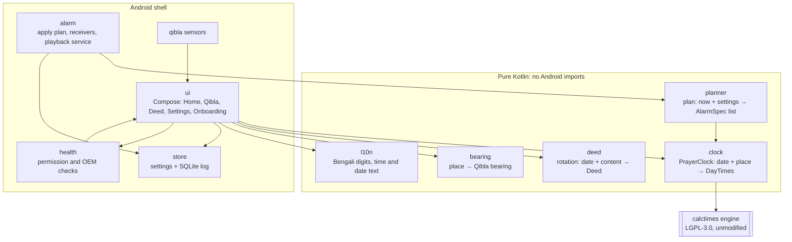
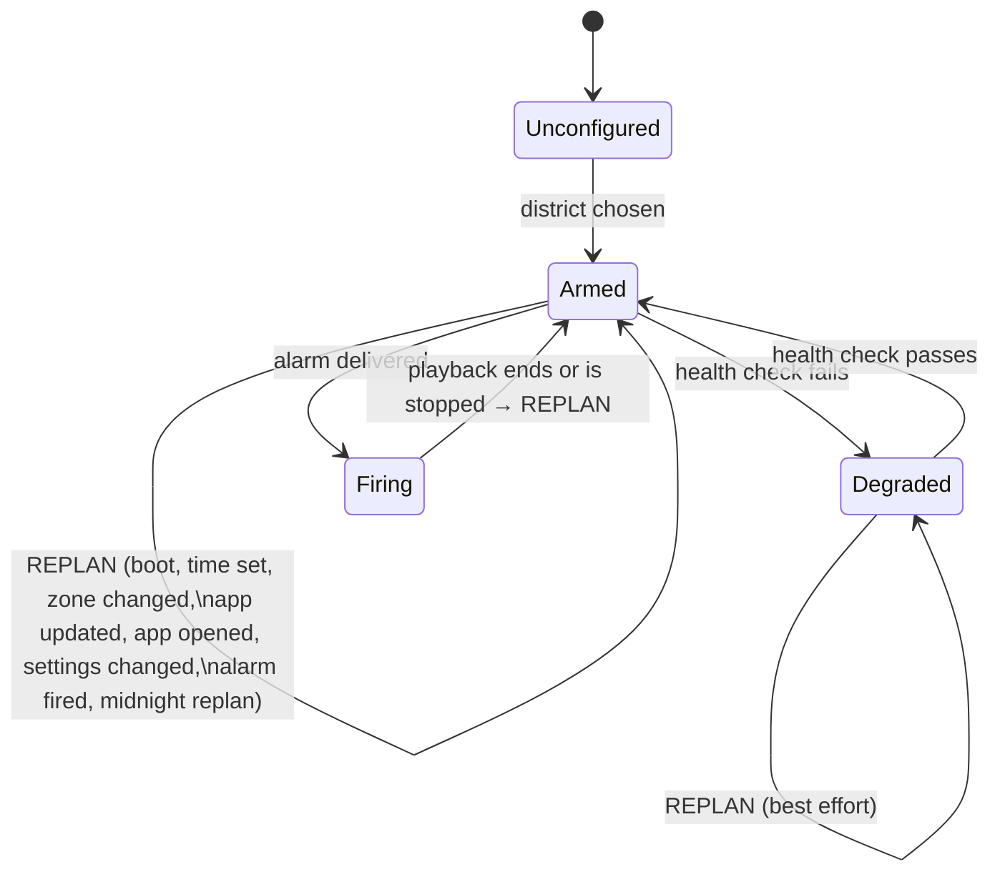

# 03 · Architecture

Labels and shorthand are as in `00-base-audit.md`. This file describes the design; it contains no application code.

**One sentence.** One Android app, one app module plus a plain Kotlin core (ADR-9), no backend, no network, with a pure core (time engine wrapper, alarm planner, deed rotation) and a thin Android shell around it.

## Context

There is no server box in this diagram, on purpose.

## Components

Rule: nothing in `pure` may import `android.*`. CI enforces it with a text check (no extra dependency).

## The time engine as a pure library

**Interface (described, not coded).**

- Input: `date`, `place` (latitude, longitude, fixed elevation, zone id), `settings` (Asr convention, per-prayer offsets in minutes, Sehri margin).
- Output: either `DayTimes` (sehriEnd, fajr, sunrise, dhuhr, asr, maghrib, isha, each an instant in the place's zone) or `NotComputable(prayer, reason)`.
- Errors are values. The wrapper never returns 00:00 for a failure (INV-T7; the engine does: KNOWN, `E/DoubleTimes.kt`).
- Method is fixed to Karachi (KNOWN present: `E/Method.kt`). Elevation comes from the district table, not GPS.
- The wrapper passes user offsets through the engine's own per-prayer minute fields (KNOWN to exist: `E/Method.kt`), so there is one offset mechanism, not two as in the base (audit §2).

**Property tests.** Random dates across 2020-2040 and random points in Bangladesh's bounding box:

1. Order: `sehriEnd ≤ fajr < sunrise < dhuhr < asrShafi < asrHanafi < maghrib < isha` (INV-T1).
2. `iftar == maghrib`; `sehriEnd == fajr − margin` under the agreed rounding (INV-T2, INV-T5).
3. Determinism: result is identical whatever the JVM default zone and locale (INV-T3).
4. Offset linearity: offset N on one prayer shifts only that prayer by N (INV-T6).
5. Continuity: from one day to the next, no time moves by more than 3 minutes **(target)**; catches date and zone slips.
6. Zone stability: converting results to UTC gives the same instants whether the device zone is Asia/Dhaka, UTC or America/New_York.

**Fixture tests.** A committed table of the reference timetable for eight cities × 365 days (INV-T4). Source is Q2.

## The scheduler as a state machine

**The base's model** is "one alarm, each fires and sets the next" (KNOWN, audit H4). **The new model** is "always hold the next 24 hours; replan on every trigger".

**Pure part: `plan(now, settings) → AlarmSpec[]`.** Each spec has a stable id, an instant, a kind (adhan · tone · silent · pre-reminder · replan) and a prayer. The plan always includes every enabled prayer in `[now, now + 24 h]` plus one `replan` spec shortly after local midnight. Being pure, it is tested without a device (INV-S2).

**Android part: `apply(plan)`.** Cancel every id in the fixed id space, then register the plan. The id space is small and closed (4 day-slots × 16 kinds = 64 ids; id = `epochDay mod 4` × 16 + kind slot, so the same alarm keeps its id across replans), so "cancel all, set all" is cheap and makes scheduling idempotent (INV-S4).

**Events that trigger REPLAN.** Boot completed; time set; time-zone changed; my-package-replaced; exact-alarm permission state changed; app brought to foreground; any settings change; any alarm delivered; the midnight replan alarm. The base handles the first three and app start only (KNOWN, audit §3).

**Persisted.** Settings (district, offsets, per-prayer mode, silent-mode choice). The alarm log (planned instant, delivered instant, outcome), trimmed to 30 days. **Not persisted:** the plan itself. It is always recomputed, so it cannot go stale.

**Health check → Degraded reasons, each with its own message and one-tap fix.**

| Reason | Detected by | Label |
|---|---|---|
| Exact alarms not allowed | `canScheduleExactAlarms()` | KNOWN API (alarms doc) |
| Notifications blocked | Notification manager state | ASSUMED API |
| Battery optimisation applies to the app | `isIgnoringBatteryOptimizations` | KNOWN, used in `A/times/utils/BatteryOptimizations.kt` |
| An alarm in the last 7 days was delivered more than 2 min late, or never | The alarm log | Own design |
| Manufacturer known for killing apps, and the user has not confirmed the per-brand steps | `Build.MANUFACTURER` | ASSUMED |

**Delivery.** Adhan alarms use `setAlarmClock`, as the base does by default (KNOWN, `A/MyAlarmManager.kt`); the platform documents it as leaving low-power modes to deliver (KNOWN, alarms doc). Silent and pre-reminder alarms use `setExactAndAllowWhileIdle`. On delivery the app starts a `mediaPlayback` foreground service, as the base does (KNOWN, `AlarmService.kt`), holds a wake lock for the length of the recording plus a margin, plays, logs, replans.

**How each Phase 2 failure mode is handled.**

| F1 # | Handling |
|---|---|
| 1 Doze | `setAlarmClock` |
| 2 OEM killer | 24-hour window means one lost process does not break the chain; log exposes misses; per-brand onboarding |
| 3, 12 Exact permission | Degraded state with visible warning; replan on permission-state broadcast |
| 4 Notifications blocked | Degraded state; playback does not depend on the notification (ASSUMED; verify) |
| 5 No location | Stored district only |
| 6, 7 Spoof / travel | Ask before changing district |
| 8 Zone mismatch | Planner works in the place's zone (INV-S2) |
| 9, 10, 11 Clock, boot, update | REPLAN events |
| 13 Midnight | Planner works on instants, not on "today's list"; no hour heuristic |
| 15, 16 Silent, call | Decided at delivery from the user's one setting and audio-focus state |
| 17 Late | INV-S7 rule at delivery |

**What cannot be guaranteed, and how the user is told.**

- **Force stop.** Nothing runs until the app is opened (ASSUMED platform behaviour). Onboarding states it once.
- **OEM "autostart" disabled.** After a reboot the app may not be allowed to start (KNOWN for Xiaomi, dontkillmyapp.com; other brands UNKNOWN). The Reminder-health screen shows the miss the next time the app is opened and repeats the brand steps.
- **Before first unlock after reboot.** UNKNOWN whether alarms set from a direct-boot receiver are worth the complexity. Measure on the matrix first; default is not to support it.
- **`setAlarmClock` side effect.** The system may show an alarm icon and treat the next Adhan as the phone's "next alarm" (ASSUMED). If users object, the fallback is `setExactAndAllowWhileIdle` for all kinds, with weaker Doze guarantees. Decide on device evidence.

## Data layer

| Data | Where | Why |
|---|---|---|
| Settings | Platform SharedPreferences, one file, versioned keys | Small, no dependency |
| Alarm log, deed completions | One SQLite database through the platform's own helper, two tables | No dependency; SQLite is what Quran search will need later |
| Deeds | `content/deeds.json`, packaged as an asset, parsed with the platform JSON parser | Reviewer-editable, diffable |
| Districts | `content/districts.json` asset: id, names (bn, en), latitude, longitude, elevation | 64 rows |
| Adhan audio | One file in `res/raw` | License: Q5 |

**Schema.** `alarm_log(id, prayer, kind, planned_utc, delivered_utc NULL, outcome)`; `deed_day(local_date PRIMARY KEY, deed_id, content_version, swapped, done_at NULL)` (was `deed_done`; one row per day the card was shown, amended 2026-11-26, G5). **Migrations.** Numbered SQL files applied in order; a test opens each historical schema and migrates to current.

**Backup.** Settings and deed completions may be included in Android's backup; the alarm log is excluded. After a restore the health check runs (failure mode 12). Exact backup-rule syntax: UNKNOWN here, take from Android docs.

**Size budget (targets).** Code and resources ≤ 6 MB, audio ≤ 2 MB, content ≤ 0.1 MB, total download ≤ 15 MB. Actuals: UNKNOWN until the first build.

**Bundled vs downloaded.** v1: everything bundled, nothing downloaded.

## Localization architecture

| Topic | Decision | Label |
|---|---|---|
| Default locale | Bengali strings live in the default `values/` folder; English in `values-en/`. A phone in any other language sees Bengali. A per-app language setting offers বাংলা / English | Design choice; per-app locales are KNOWN supported by the base (`locales_config.xml`) |
| Completeness | Build fails on any key missing in either language (INV-L1) | The base's 37 % Bengali coverage is the cautionary case (audit H2) |
| Digits | One pure function maps 0-9 to ০-৯ for all numbers shown in Bengali; property-tested over all ten digits. The base's version skips 9 and has no Bengali (KNOWN, `LocaleUtils.kt:225`) | Design choice |
| Time format | 12-hour with Bengali day-part words (ভোর, দুপুর, বিকাল, সন্ধ্যা, রাত) as the default; 24-hour as an option. Wording to be confirmed with native speakers | ASSUMED preference; test with users |
| Dates | Gregorian date in Bengali. Bengali-calendar and Hijri dates are **not** in v1 | Cut; Hijri needs the ±1 decision |
| Plurals | Android plural resources for every counted phrase, even where Bengali uses one form | ASSUMED Bengali has one/other forms only; verify in CLDR |
| Arabic inside Bengali/English | Wrap every Arabic run in Unicode directional isolates through the platform's bidi helper | ASSUMED API |
| Fonts | Start with system fonts. Check Bengali conjuncts and Arabic diacritics on every phone in the matrix. Bundle a font only if a phone fails | UNKNOWN until tested; a bundled Bengali font costs install size (amount UNKNOWN) |
| Text expansion | Layouts sized for the longer of the two languages at 200 % font scale (INV-L4) | |
| Translation process | Bengali is written first by a native speaker, not machine-translated from English. No Crowdin in v1: two languages do not need it | Cut |

## Privacy architecture

**Permission allowlist. The build fails if the merged manifest differs (INV-P3).**

| Permission | Reason shown to the user |
|---|---|
| `USE_EXACT_ALARM` (Android 13+) and `SCHEDULE_EXACT_ALARM` (Android 12) | Ring the Adhan at the exact time. See ADR-4 |
| `RECEIVE_BOOT_COMPLETED` | Set the alarms again after a restart |
| `POST_NOTIFICATIONS` | Show the prayer notification |
| `FOREGROUND_SERVICE`, `FOREGROUND_SERVICE_MEDIA_PLAYBACK` | Play the Adhan |
| `WAKE_LOCK` | Keep the phone awake while the Adhan plays |
| `VIBRATE` | Vibrate if chosen |
| `ACCESS_COARSE_LOCATION` | Find your district and Qibla. Optional; a district can be picked by hand |

Removed relative to the base (KNOWN list, audit §3): `INTERNET`, `ACCESS_NETWORK_STATE`, `ACCESS_FINE_LOCATION`, `DISABLE_KEYGUARD`, `ACCESS_NOTIFICATION_POLICY`, `FOREGROUND_SERVICE_SPECIAL_USE`, `SET_ALARM`, `INSTALL_SHORTCUT`.

**Network allowlist.** Empty. `INTERNET` is not declared (INV-P1). A CI check greps the merged manifest.

**Crash reporting.** None automatic. A "Send a report" button in Settings opens the user's email app with a plain-text draft they can read: app version, Android version, manufacturer and model, health-check results, the 7-day alarm log. No identifiers. The user chooses whether to send. This is the only way information leaves the phone, and it does not need the `INTERNET` permission.

**Location.** Read on demand from the platform location service at coarse precision; never in the background; stored only as a district id or rounded coordinates.

## Dependency policy

Default answer is no. Allowlist (INV-P4):

| Dependency | License | Why it exists | Cost of removing |
|---|---|---|---|
| Kotlin stdlib | Apache-2.0 (ASSUMED) | Language | Not removable |
| `calctimes` engine | LGPL-3.0 (KNOWN) | Prayer time calculation | ADR-2 |
| `kotlinx-datetime` | Apache-2.0 (ASSUMED) | Required by the engine's API (KNOWN, `calctimes/build.gradle.kts`) | Goes if the engine is replaced |
| Jetpack Compose + Material 3 + Activity | Apache-2.0 (ASSUMED) | UI | A rewrite in Views; more code, not less |
| Core library desugaring | (ASSUMED permissive) | `java.time` on older Android, as the base does (KNOWN, `app/build.gradle`) | Raise minSdk |
| Test only: JUnit, a property-testing library (the base already uses Kotest: KNOWN) | (ASSUMED permissive) | Tests | None shipped |

Sizes: UNKNOWN until built. Verify every license from the generated dependency report before release.

**Explicitly refused:** Ktor, Ion, Room, WorkManager, DataStore, a DI framework, a navigation library, an image loader, Sentry or any crash SDK, Firebase, Google Play services, kotlinx-serialization, AboutLibraries, Flexmark. Each solved a problem v1 does not have.

## Build, release, update

- **Signing.** Play App Signing with an upload key kept offline and backed up. (Process details: take from Play Console at setup.)
- **Flavours.** None. One build.
- **Application id.** New and unrelated to `com.metinkale.prayer`.
- **Versioning.** `versionName` = `major.minor.patch`; a separate integer `contentVersion` for deeds.
- **Rollout.** Closed test with ≥ 12 testers for 14 days (KNOWN requirement), then staged production rollout at increasing percentages **(targets: 10 → 50 → 100 %, holding 48 h each)**, watching the "Send a report" inbox and Play's own vitals.
- **Content updates without code.** A content change touches only `content/*.json` and the reviewer's note, and ships as an ordinary app update. No Kotlin changes, no feature flags. Over-the-air content waits for the Quran work.
- **Store listing.** Bengali first, English second; screenshots from the redesigned UI only; no upstream assets.
- **Attribution.** A `NOTICE` file and an in-app "Open-source licences" screen credit prayer-times-android (Apache-2.0) for any ported code, and reproduce the engine's LGPL notices (KNOWN required by `calctimes/NOTICE.txt` and `open-prayer-times/README.md:65-72`).

## Forward path

| Later feature | Where it attaches | What v1 must not do |
|---|---|---|
| Quran, tafsir, audio | A new `packs` component: download, verify hash, store, index in the existing SQLite database. Adds `INTERNET`, allowlisted to one host | Must not scatter storage across files and preferences |
| Duas, daily hadith | Same content record shape and review gate as deeds | Must not hard-code "deed" into the gate |
| Salah tracker | A third table; a "Prayed" action on the notification the alarm component already posts | Must not let notifications be built in more than one place |
| Hijri, ±1 day | The engine repo's `hijri` module (Apache-2.0, KNOWN) behind the `clock` interface | Must not format dates outside `l10n` |
| Widgets | Read the planner's output | Must not let UI compute times itself |
| Paid tier | A single `entitlements` interface that returns "everything" in v1 | No billing code, no stubs beyond the one interface |
| Sync / accounts | Not planned. If ever: export/import of one file first | No account concepts in v1 |

---

## Decision records

### ADR-1 · New app that ports parts, not a pruned fork

- **Context.** The audit's deletion list removes most modules, both flavours' extras, all networking and 49 languages (audit §10). State is spread over SharedPreferences and static singletons (`A/times/times/TimesCompanion.kt`, `A/App.kt`), the scheduler has no tests, and upstream asks for a real redesign (`README.md:159-161`). Play disallows apps that merely replicate existing ones (KNOWN).
- **Options.** (a) Fork and delete down. (b) Start an empty project; port the engine call, the Qibla bearing maths and sensor filter, and the proven alarm delivery pattern, with attribution.
- **Decision.** (b).
- **Consequences.** More typing in week one. Far less inherited behaviour to understand. Upstream fixes no longer merge; they are read and ported by hand. Clear answer to both the author's request and the Play policy.
- **Reverse.** If slice 1 takes more than two weeks **(target)**, fall back to (a) using `00-base-audit.md` §10 as the deletion script.

### ADR-2 · Keep the LGPL engine, unmodified, behind an interface

- **Context.** `calctimes` is LGPL-3.0 (KNOWN). It is pure, already has Karachi and Hanafi, and is what the reference app ships.
- **Options.** (a) Use it unmodified as a separate library and comply with LGPL. (b) Replace it with a permissively licensed engine (candidates and their licenses: UNKNOWN, not researched in this run). (c) Write a new implementation from published astronomical formulas.
- **Decision.** (a) now. Do not modify the engine; if a change is ever needed, publish it. Get a written legal opinion on LGPL compliance in a Play-distributed app before any paid tier (Q6).
- **Consequences.** Licence notices in the app. A legal question stays open. No engine work in v1.
- **Reverse.** The `clock` interface plus the fixture table make a swap mechanical: any engine that passes T-FIX-4 and the property tests is acceptable.
- **Amended 2026-11-26 (founder decision, gap G1).** "Unmodified" could not stand. The engine's public output is already rounded, with Fajr rounded down, and it turns a failed calculation into 00:00 (KNOWN, `DoubleTimes.kt` at `a136f9b`), so INV-T5 and INV-T7 cannot be met from outside it. The engine is now **vendored at `engine/calctimes/` with one change**: `DoubleTimes` and `CalcTimes.getDoubleTimes` are public. The change is recorded in `engine/calctimes/MODIFICATIONS.md`. LGPL duty that follows: the modified engine source must be offered to anyone who gets the app; a public repository containing `engine/calctimes/` satisfies that (ASSUMED; part of Q6). Vendoring also closes G3: upstream publishes no artifact to depend on.

### ADR-3 · Hold a 24-hour window of alarms; recompute, never persist

- **Context.** The base holds one alarm and chains (KNOWN). One lost link silences the app until the next boot or app open, and its daily repair job needs internet (S1, S2).
- **Options.** (a) Keep the chain. (b) 24-hour window, replan on every event, cancel-all-then-set. (c) Schedule a week ahead.
- **Decision.** (b).
- **Consequences.** Up to about a dozen pending alarms instead of one. Losing any one costs one prayer, not all. (c) adds nothing: times drift daily and a replan happens daily anyway.
- **Reverse.** The planner's window length is one constant.
- **Amended 2026-11-26 (founder decision, gap G8).** The window is **48 hours**, not 24. With 24, a phone that freezes the app after the last alarm loses every reminder the same day, which is the base's failure delayed by a few hours. With 48 the user gets a further day of reminders, and a day in which opening the app once repairs everything. About twenty pending alarms instead of ten. "24 hours" elsewhere in this file and in `02` now reads 48.
- **Also decided 2026-11-26 (gap G16).** A prayer whose time has passed when the plan is made is skipped silently. An alarm is planned only if its instant is strictly after "now", so replanning while an alarm fires cannot ring it twice (INV-S5). A pre-reminder is 1 to 120 minutes, so it can never share an instant with its own prayer. Two different prayers' alarms may share an instant (a long pre-reminder landing on the previous prayer); both are planned and the shell plays them in order.

### ADR-4 · Exact-alarm permission

- **Context.** `USE_EXACT_ALARM` is granted at install and cannot be revoked, and is described for calendar and alarm-clock apps; `SCHEDULE_EXACT_ALARM` is user-granted, off by default on fresh installs targeting Android 13+, and revocable (all KNOWN, Android docs). Play requires that exact alarms be core functionality (KNOWN). Whether Play accepts an Adhan app under `USE_EXACT_ALARM`: UNKNOWN. The base declares both and is on Play (KNOWN it declares both; its Play review history is UNKNOWN).
- **Options.** (a) Declare both, as the base does. (b) `SCHEDULE_EXACT_ALARM` only, with a grant step in onboarding.
- **Decision.** (a), with the Degraded state and grant flow built regardless, so (b) is a manifest edit away.
- **Consequences.** Best reliability if accepted. A rejection costs one review cycle.
- **Reverse.** Remove one manifest line; the grant flow already exists.

### ADR-5 · Platform storage only

- **Context.** v1 stores a handful of settings and two small tables.
- **Options.** (a) Room + DataStore. (b) SharedPreferences + platform SQLite helper.
- **Decision.** (b).
- **Consequences.** Hand-written SQL for two tables; no annotation processor, faster builds, two fewer dependencies.
- **Reverse.** Adopt Room when the Quran schema arrives, if hand-written SQL becomes the bottleneck.

### ADR-6 · No network in v1

- **Context.** The base sends coordinates to a server for city lookup (KNOWN, H5) and downloads sounds and data. The product promise is offline and private.
- **Options.** (a) Keep city search online. (b) Bundle 64 districts and one Adhan; declare no `INTERNET`.
- **Decision.** (b).
- **Consequences.** The privacy claim becomes checkable by anyone reading the permission list. Bangladesh only. No remote content fixes; a wrong deed needs an app update.
- **Reverse.** Add `INTERNET` with a one-host allowlist when content packs arrive.

### ADR-7 · No automatic crash reporting

- **Context.** The base's Play flavour sends crashes with a per-install id (KNOWN, H7). Mu'mins DAY's positioning forbids trackers, yet F1 cannot be perfected blind.
- **Options.** (a) Self-hosted crash collector, opt-in. (b) On-device log plus user-initiated email. (c) Nothing.
- **Decision.** (b), plus Play's built-in vitals, which need no SDK (ASSUMED).
- **Consequences.** Fewer reports, each with full consent and context. No server to run.
- **Reverse.** Add an opt-in collector later behind the same "Send a report" screen.

### ADR-8 · Coarse location, fixed elevation

- **Context.** The base requests fine location and feeds GPS altitude into sunrise and sunset (KNOWN, audit §2, §3).
- **Options.** (a) Fine location and live altitude. (b) Coarse location, snapped to a district with a fixed elevation.
- **Decision.** (b).
- **Consequences.** Times are stable from day to day and identical for neighbours, which is what a mosque timetable looks like. The error from coarse position is a small fraction of a minute across a district (ASSUMED; compute east-west spread per district and confirm ≤ 1 min, else subdivide).
- **Reverse.** Offer "use my exact position" as an advanced switch.

### ADR-9 · A plain Kotlin `:core` module beside the Android app

- **Date.** 2026-11-26. Founder decision (gap G18).
- **Context.** The one-sentence summary above says "one Gradle module". The pure core (clock, planner, deed rotation, bearing, l10n) has no Android imports by rule. Google's Maven host is unreachable from the cloud environment where much of the work is done, so an Android module cannot build there (KNOWN, `curl`, 2026-11-26); Maven Central can.
- **Options.** (a) One Android module; build only on the founder's machine. (b) `:core` as a plain Kotlin JVM module, `:engine:calctimes` as the vendored engine, `:app` as the Android shell added in slice 3.
- **Decision.** (b).
- **Consequences.** The "no `android.*` in pure code" rule is now enforced by the compiler, since `:core` has no Android on its classpath; the text check stays as a second guard against clock and locale reads. Core tests run in seconds on any machine. Three modules instead of one. "One Gradle module" in the summary now reads "one app module".
- **Reverse.** Move `core/src` into the app module; packages do not change.
